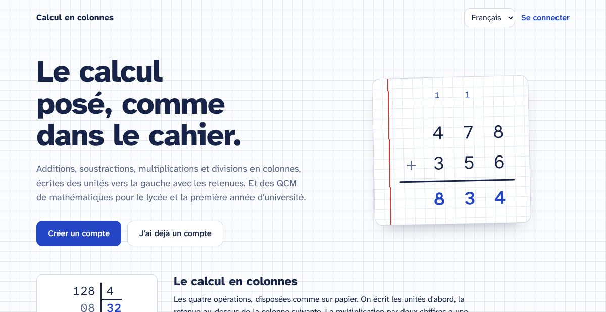

# Luma

A web app for practising arithmetic the way it is written on paper, for
multiple-choice tests in secondary-school and first-year university
mathematics, for vocabulary (Spanish, English, Japanese) with spaced repetition, and
for experiments to discover probability. French, Spanish
and English interface; one server, one small database; sign-in by password or
Google, Microsoft, GitHub and other OpenID providers; installable on a phone's
home screen.

The project and its folder keep their first name, `calcul-colonnes`.

<p>
  
</p>

<p>
  
  
  
  
</p>

## What it does

**Column arithmetic** — for children learning the written methods.

- Addition, subtraction, multiplication and Euclidean division, laid out as on paper.
- Answers are typed from the units leftwards; an optional carry row sits above the columns.
- Multiplication by a two-digit number gets one line per partial product, then the total.
- Division uses the bracket layout, with working lines under the dividend, the quotient under the divisor, and the remainder.
- Adjustable ranges: largest number 20 to 1000; multiplier and divisor 2 to 12.
- A one-click A4 PDF worksheet of 20 operations, ready to print.

**Multiple-choice tests (QCM)** — sequences, derivatives, integrals, trigonometry, limits,
exponentials and logarithms, differential equations, complex numbers and probability,
at *lycée / bachillerato* or university level.

- Questions are generated, not drawn from a fixed bank: 110 kinds of question in 15 topics, with graph questions and typed numeric answers, each with its own parameters.
- The wrong options are typical mistakes, such as an exponent not lowered, the inner derivative forgotten, a sign error, or in probability P(A | B) taken for P(B | A) and the base rate ignored.
- Every test ends with a corrected review and a short explanation per question.
- Each test is defined by a seed; the server regenerates it to grade it, so the browser is never trusted with the result.
- An automated check verifies tens of thousands of generated questions numerically, independently of the generators.

**Chemistry and biology** — a test on balancing chemical equations, and four labs.

- Equations generated from five families (combustion, synthesis, neutralization, displacement, decomposition), balanced exactly; the wrong options are the classic slips: a subscript changed instead of a coefficient, coefficients not the smallest, an element left unbalanced, O₂ written O.
- Labs: building molecules (bonds from valences, shapes from lone pairs), Mendel's peas (Punnett squares, seeded offspring, chi-square), why cells are small (surface, volume, diffusion), hares and lynxes (Lotka–Volterra cycles).

**Astronomy** — four labs on geometric models: the Moon's phases (not the Earth's shadow), the seasons (the tilt, not the distance), eclipses (the tilted orbit), and the planets' orbits (Kepler's laws, Mars going backwards).

**Linux** — multiple-choice tests on the command line: files and permissions, text processing, the shell, processes and services, the system, the network, bash scripting, git, vim, and tools worth installing.

**SQL** — multiple-choice tests on SQL and databases: reading, aggregating and joining, changing data and schemas, transactions and indexes; PostgreSQL with psql, SQLite with sqlite3, MySQL and MariaDB with mysql; and good practice (design, injection, performance, backups and migrations). Questions on what a query returns are generated on random tables and checked on a real SQLite database, and on PostgreSQL.

**Rust** — multiple-choice tests at four levels, from a first program to async and unsafe: variables and types, ownership, borrowing and lifetimes, structs, enums and traits, errors, collections, iterators and closures, threads and async, Cargo, modules and tests, macros, unsafe and FFI. Questions on what a short program prints are generated and checked by compiling and running them with rustc.

**TypeScript** — multiple-choice tests at four levels: types and inference, functions and closures, interfaces and classes, unions and narrowing, generics, mapped and conditional types, where the type system is unsound, the JavaScript that runs underneath (equality, the event loop, async, numbers, copies), and the tooling (tsconfig, modules, strict options, TypeScript 7, Node's type stripping). Questions on what a short program logs are generated, type-checked with tsc and run.

**React** — multiple-choice tests at four levels, on React 19 and the stack around it: components and JSX, state and events, effects and refs, rendering and performance (the React Compiler, transitions, `<Activity>`), data (Actions, `use`, server components, streaming), React with TypeScript, Vite and deployment, and tests with Vitest, Testing Library and Playwright. Questions on what a short component shows on the page or in the console are generated, type-checked with tsc and rendered with React DOM.

**Google Cloud** — multiple-choice tests at four levels, focused on identity and access and on infrastructure: the resource hierarchy and organisation policies, IAM (roles, conditions, deny policies, principal access boundaries, Privileged Access Manager), service accounts, impersonation and federation, audit logs, VPC Service Controls and KMS, VPC networks, firewalls and load balancing, Cloud Run and GKE, storage, Terraform and reliability. Questions on IAM through the hierarchy, firewall rules and policies, subnets, Cloud Run's scaling and availability are generated, each answer computed again by an independent evaluator.

- 254 questions written for the app, in French, Spanish and English, from `find` and `sed` to `systemctl`, `ssh`, `rsync` and `dig`, `git rebase` and vim's text objects.
- Tools missing from a default install (`ripgrep`, `fzf`, `jq`, `tmux`, `hyperfine`, `shellcheck`, `nmap`…) are marked with their package and the install command for Debian, Fedora and macOS.
- `chmod`, `umask` and crontab questions are generated, with the usual slips as wrong options; an octal mode can be typed.
- "What does this print?": `sed` substitutions, `awk` fields and bash's `${f%.*}` on generated input. The wrong outputs are real slips (the `g` flag, fields counted from 0, `#` for `%`), and the check runs every command with the real bash, sed and awk.

**Physical chemistry** — multiple-choice tests from *Atkins' Physical Chemistry* (12th edition), a book you own: Focuses 1 to 8, 11 to 13, 17 and 18, from gases and the laws of thermodynamics to quantum theory, atomic and molecular spectra, NMR and EPR, statistical thermodynamics, kinetics and reaction dynamics.

- Calculations are generated like the maths questions: 122 kinds, from the perfect gas law to the Nernst equation, hydrogenic spectra, rotational lines, Larmor frequencies, partition functions, half-lives, the Arrhenius and Eyring equations and Marcus theory, with data to three significant figures and units in the options. The wrong options are unit slips and real mistakes: °C for K, kJ mixed with J, C_p for C_V, a log₁₀ for a ln, the ions of a salt counted as one particle, electrode potentials weighted by electrons.
- Concept questions are written from the book, Topic by Topic, and imported from a file kept out of the project: 647 for Topics 1A–8C, 11A–13F and 17A–18E. Each shows its section of the book ("Atkins 2B.1") and explains the answer.
- An advanced level of 257 reasoning and derivation questions: free expansion of a van der Waals gas, the Gibbs paradox, entropy of water compressed below 4 °C, a concentration cell, the Harned cell.
- In French, Spanish and English: texts are stored per language, never in the code.
- Any question can be flagged from the corrections, with a note, for the author to check.

**Vocabulary** — from books you own, imported once: Spanish, German, Arabic and Japanese with translations, English with definitions. Plus kanji and kana in the Japanese school's order.

- Their chapters are the lessons and their sections the sections. *Spanish*, *German* and *Arabic 3000 words and phrases* and *Vocabulary 4000* are read automatically from their PDF, *Japanese vocabulary for English speakers* from its EPUB; any other list can be written as a simple JSON file.
- A translation is chosen or written; a definition is chosen and the word written.
- Spaced repetition with Leitner boxes: each word, in each direction, comes back after 10 minutes, then 1, 3, 7, 16 and 35 days, and starts again after a mistake.
- Learn a section or a chapter; review a section, a chapter or the whole vocabulary, weakest words first.
- Multiple choice while a word is new, written answers once it is known. Accents and one-letter slips are forgiven with the spelling shown; a wrong article is not. In German, *ss* for *ß* and *ae*, *oe*, *ue* for umlauts are right.
- The book's own notation is understood: `el amigo / la amiga`, `Buenas tardes / noches`, `embarcar(se)`.
- Japanese comes with its rōmaji, and is answered in kanji, kana or rōmaji: 学校, がっこう, *gakkō* and *gakko* are all right.
- Arabic reads right to left with its transliteration, and is answered in Arabic script, vowel marks optional, or in transliteration: الأُسبوع, الأسبوع and *al usbou’* are all right.
- Statistics per book: progress by lesson, the last 30 days, the reviews coming, the hardest words.
- **Kanji and kana:** hiragana, katakana and the 2,136 jōyō kanji, grade by grade as in Japanese schools. A kanji is learnt three ways: its meaning (in French, Spanish or English), its readings (in kana or rōmaji) and the kanji from its meaning. Example words use only kanji already learnt. Characters met in your Japanese words come first, and each card shows the other side: a character's words, a word's kanji. Built from KANJIDIC2 and JMdict (EDRDG, CC BY-SA), downloaded by you.

**Discover** — experiments rather than exercises: predict, observe, explain.

- The probability lab: predict which sum of two dice comes up most often, roll 1 to 1,000 times, watch the counts and the share of 7s settle, then compare with the 36 ways the dice can land.
- Heads or tails: predict the longest streak in 100 flips, watch what follows a streak (one in two, still), and see why six heads in a row is exactly as likely as any mixed sequence of six.
- Logic grids, four levels from 4 × 4 to 6 × 6 with cages (+ − × ÷): every grid has one solution and can be solved without guessing, and the hints explain the next deduction instead of giving the number.
- Each experiment and each grid has a number: the same number replays the same rolls, flips or grid, to compare with someone.
- Checked, not assumed: millions of rolls and flips per seed against the theory by chi-square tests, the exact streak formulas against a brute-force count of every sequence, and 1,200 grids for one solution and a solution by reasoning.

**Physics** — the same pattern, with simulations: predict, try, compare with the theory.

- Throw a ball (the anchor): pick the angle that throws farthest, plant a flag where a throw at 30° will land, then throw at any angle, speed and height. The flight is integrated force by force and shown as it happens; the formula then gives the same distance, to the millimetre.
- The pendulum: does a heavier ball swing faster? Time 10 swings at any length, mass and angle; the motion is computed with the full sin θ, so large angles really do swing slower.
- Lenses: move the arrow and the screen until the image is sharp, then cover half the lens with a card. The rays are traced one by one; the thin lens equation and a three-ray diagram come after.
- Circuits: six circuits of identical bulbs, solved by Kirchhoff's laws; bulbs glow by their power, ammeters show that current is not used up, and any bulb can be unscrewed.
- Each simulation is checked against the exact solution: the flight against the parabola, the pendulum's period against the elliptic integral up to 170° with no energy drift over 100 swings, traced rays against the lens equation, circuits against the series and parallel formulas.

**Players and progress**

- Scores are kept per player in SQLite, or in PostgreSQL (Neon) with one setting.
- A parent's account chooses which activities each child sees, and can share a child with another account (the other parent, a teacher) with a single-use code.
- Every test answer is filed under its kind of question. A kind answered wrong comes back in later tests until it has been answered right twice in a row.
- Every wrong option stands for a typical mistake (137 types, such as *inner derivative forgotten*, *solution missed* or *°C used for K*). The mistake is shown in the corrections and counted per player.
- Each activity shows its own progress: status per kind of question and frequent mistakes for each test subject, results per operation for column arithmetic, statistics for each vocabulary book. An overview gathers them all, with today's work.
- Each vocabulary lesson lists its words; a word the child already knows can be skipped, and put back later.

## Quick start

Requirements: Node.js 20.12 or later (developed on Node 22).

```sh
npm install
cp .env.example .env
npm run dev
```

Open <http://localhost:5173> and create your account. The API runs on port
8787. The SQLite database is created in `./data/` on first start. To try a
sign-in provider in development, set `PUBLIC_URL=http://localhost:5173` so the
provider returns through Vite.

For production, one process serves both the built app and the API:

```sh
npm run build
npm start          # http://localhost:8787
```

## Scripts

| Command | What it does |
|---|---|
| `npm run dev` | API (with reload) and Vite dev server together |
| `npm run build` | Type-checks the browser and server code, then builds the app into `dist/` |
| `npm start` | Runs the server: API, plus the built app if `dist/` exists |
| `npm run check:quiz` | Generates thousands of tests and verifies every question (see [question generators](docs/question-generators.md#verification)) |
| `npm run test:e2e` | Browser tests of the whole app, on a separate server and database (see [Development › Tests](docs/development.md#tests)) |
| `npm run vocab:import -- data/vocab-english.json` | Imports a vocabulary book, keeping progress on unchanged entries (see [Vocabulary](docs/vocabulary.md)) |
| `npm run quiz:import -- data/atkins-12-concepts.json` | Imports the question bank written from a textbook, keeping old tests exact (see [Question bank](docs/question-bank.md)) |
| `npm run quiz:flags` | Lists the questions players flagged; `-- --resolve N` closes one |
| `npm run check:vocab` | Checks the vocabulary grading, scheduling and statistics; with a file, every entry |
| `npm run check:family` | Checks sign-up by invitation, the owner's page, content other accounts may not see, export and account deletion (see [Authentication › Family release](docs/authentication.md#family-release)) |
| `npm run characters:build` | Builds the kanji and kana book from the EDRDG dictionaries in `data/` (see [Kanji and kana](docs/characters.md)) |
| `npm run check:discover` | Checks the Discover engines: exact probabilities and streak formulas, the generator on millions of trials, 1,200 logic grids (see [Discover](docs/discover.md#checks-and-tests)) |
| `npm run check:physics` | Checks the physics playground: every simulation against its exact solution, energy that does not drift, Kirchhoff's laws (see [Discover](docs/discover.md#physics-checks)) |
| `npm run check:astronomy` | Checks the astronomy models: the Moon's lit fraction and shadow, the seasons' sunlight, centuries of eclipses, Kepler against Newton (see [Discover](docs/discover.md#astronomy-checks)) |
| `npm run check:biology` | Checks the chemistry and biology labs: unique bonds, Punnett squares and chi-square, diffusion, Lotka–Volterra (see [Discover](docs/discover.md#biology-checks)) |
| `npm run check:tour` | Checks the guided tour: the session flag, migration 023, the pages in every language, the chips against the app's labels (see [User guide › Guided tour](docs/user-guide.md#guided-tour)) |
| `npm run test:e2e:postgres` | The same browser tests on PostgreSQL, with `E2E_DATABASE_URL` naming a database that may be emptied |
| `npm run maintenance` | Migrations, backfills, new vocabulary books and session purge, then exit: what a Cloud Run release runs as a job |
| `npm run build:server` | Bundles the server into `dist-server/` for the container image |
| `npm run db:copy-to-postgres` | One-off copy of the SQLite data into the PostgreSQL database named by `DATABASE_URL` |

## Configuration

Settings are read from `.env` (see `.env.example`):

| Variable | Default | Meaning |
|---|---|---|
| `DATABASE_URL` | *(empty)* | PostgreSQL connection string. When set, the server uses PostgreSQL instead of SQLite. |
| `SQLITE_PATH` | `./data/calcul-colonnes.sqlite` | SQLite file, used when `DATABASE_URL` is empty |
| `PORT` | `8787` | Port of the server |
| `PUBLIC_URL` | `http://localhost:$PORT` | Address of the app as typed in the browser; `https://` makes cookies `Secure` |
| `REGISTRATION` | `open` | `closed` allows only the first account |
| `SESSION_DAYS`, `COOKIE_SECURE`, `TRUST_PROXY` | | See [Deployment › HTTPS and sign-in](docs/deployment.md#https-and-sign-in) |
| `STARTUP_MAINTENANCE`, `LOG_FORMAT` | from the platform | Maintenance at startup and JSON logs: on locally, off and JSON on Cloud Run. See [Deployment › Cloud Run](docs/deployment.md#cloud-run) |
| `QUIZ_BANK_FILE` | *(empty)* | A question bank file imported by the maintenance when the database has none |
| `GOOGLE_*`, `MICROSOFT_*`, `GITHUB_*`, `OIDC_*` | *(empty)* | Sign-in providers, see [Authentication](docs/authentication.md#providers-1) |

## Documentation

| Document | For |
|---|---|
| [User guide](docs/user-guide.md) | Parents and teachers: every screen, setting and keyboard shortcut |
| [Architecture](docs/architecture.md) | How the browser, server and shared code fit together; design decisions |
| [Question generators](docs/question-generators.md) | The 110 maths, 122 chemistry, 53 Linux, 33 SQL, 40 Rust, 36 TypeScript, 44 React, 40 Google Cloud and 6 balancing kinds of question, how a generator works, adding one, verification, versioning |
| [Question bank](docs/question-bank.md) | The physical chemistry concept questions: file format, import, revisions, flags, writing questions |
| [Vocabulary](docs/vocabulary.md) | Importing a book, the file format, the learning method, how answers are graded |
| [Kanji and kana](docs/characters.md) | The Characters book: school order, readings, how it works with the word books, building it |
| [Authentication](docs/authentication.md) | Accounts and players, cookies, providers setup, passkeys and email links to come |
| [Database](docs/database.md) | Schema, migrations, SQLite and PostgreSQL |
| [API](docs/api.md) | Every endpoint with request and response examples |
| [Deployment](docs/deployment.md) | Home server or Cloud Run, releases from GitHub Actions, Neon, security |
| [Development](docs/development.md) | Code layout, conventions, adding a language, checks before a release |
| [Changelog](CHANGELOG.md) | What changed, version by version |

## Project layout

```
src/            browser app (TypeScript, no framework)
shared/         code used by both browser and server
  quiz/         question generators, test assembly, progress rules
server/         API (Hono), database access, migrations, scripts
tests/e2e/      browser tests (Playwright)
docs/           documentation
```

A file-by-file description is in [Development](docs/development.md#code-layout).

## Sign-in

Accounts belong to adults and own the players; a child can also get a sign-in
of their own and then sees only their own work. Sign-in by email and
password, and by Google, Microsoft, GitHub or any OpenID Connect provider once
configured. Sessions are server-side, in an `HttpOnly` cookie. Serve it over
HTTPS when it leaves `localhost`. See [Authentication](docs/authentication.md).
