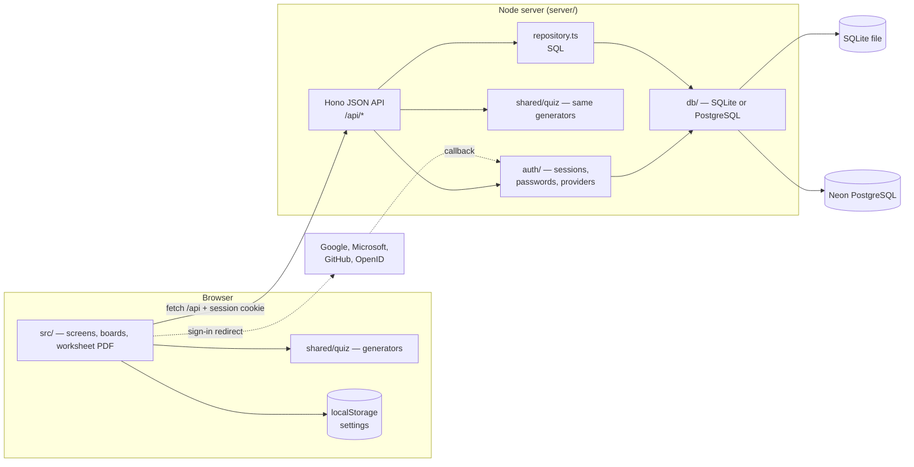
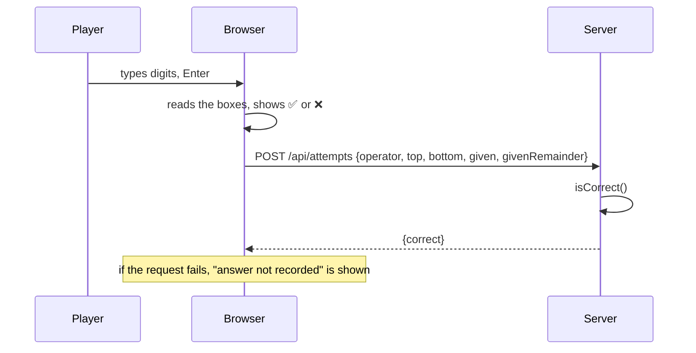
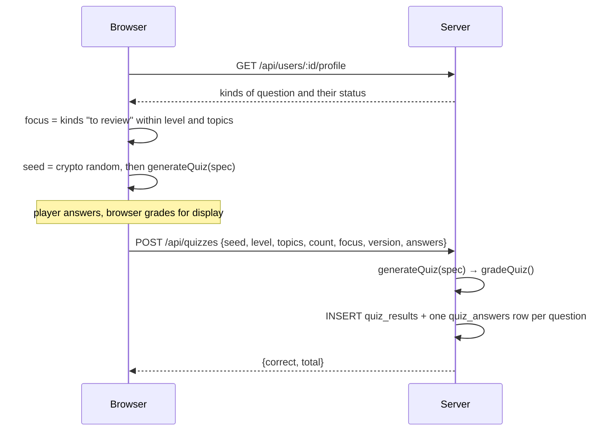

# Architecture

## Overview



Three parts, in one repository and one npm package:

| Part | Runs in | Role |
|---|---|---|
| `src/` | browser | Every screen, keyboard handling, the arithmetic boards, the PDF worksheet, browser settings |
| `shared/` | both | Types shared over the API, and the whole multiple-choice engine: generators, test assembly, progress rules |
| `server/` | Node | JSON API, sign-in and sessions, grading, database access and migrations, maintenance scripts |

In production a single Node process serves the built app (`dist/`) and the
API on one port. In development Vite serves the app on port 5173 and proxies
`/api` to the server on port 8787.

## Design decisions

### The server decides what is right

The browser shows the answer to the player straight away, but what gets
stored is the server's own verdict:

- **Arithmetic:** the browser sends the operation and the answer typed; the server computes whether it is correct (`isCorrect` in `server/repository.ts`).
- **Tests:** the browser sends only the test's definition and the options chosen. The server regenerates the test, grades it, and files each answer under its kind of question.

A modified browser therefore cannot record a result that is not the actual
answer given.

### Sessions in cookies, scope from the session

Sign-in is server-side sessions in an `HttpOnly` cookie, not tokens kept by
the page: the page's scripts never see a credential, signing out is
immediate, and there is nothing to refresh. Every data route takes the
account and, for a player's own session, the player from the session, and
filters every query by them (`Scope` in `server/repository.ts`). Players
another session may not see answer `404`. See [Authentication](authentication.md).

### A test is a seed

A multiple-choice test is never stored as text. It is fully defined by:

```
(seed, level, topics, count, focus, version)
```

`generateQuiz` in `shared/quiz/index.ts` turns this into the same questions,
options and option order in the browser and on the server. This is what makes
server-side grading possible without storing questions. It also allows
rebuilding old tests later (the progress tracking was added after tests had
been saved) and offering *Refaire le même test*.

The price is that **the meaning of a seed must never change**: see
[versioning](question-generators.md#versioning). The random generator is a
seeded mulberry32 (`shared/quiz/rng.ts`), and the generators never call
`Math.random`.

### Generated questions, checked independently

Each kind of question is a small function that draws parameters, computes the
answer and builds wrong options from typical mistakes. Correctness does not
rest on the generator's own arithmetic. Each question also carries a
description of what its answer must satisfy (`verify`): a derivative, a
primitive, an integral, a limit, roots or a value. The check script then tests
the marked answer and every wrong option against it numerically. See
[verification](question-generators.md#verification).

### One SQL dialect, two engines

Queries are written once, in the subset of SQL that SQLite and PostgreSQL
share, with PostgreSQL-style placeholders (`$1`, `$2`, translated for
SQLite). Only the migrations have one file per engine, because identity
columns and some `ALTER TABLE` forms differ. The engine is chosen by
`DATABASE_URL`. See [Database](database.md).

### No framework in the browser

The app is a few screens re-rendered from one state object (`render()` in
`src/main.ts`), using plain DOM calls through two helpers (`el`, `button` in
`src/dom.ts`). The interaction that matters (focus moving column by column,
carries, partial products, the division grid) is handled explicitly in
`src/boards.ts`. Dependencies are KaTeX for formulas, and nothing else in the
browser. The PDF worksheet is written by hand (`src/worksheet.ts`, under 200
lines, standard PDF fonts only), so it needs no library and is produced
instantly.

## Data flow

### Checking an arithmetic answer



### Taking a test



### Starting the server

`server/index.ts`:

1. Loads `.env` if present (`process.loadEnvFile`).
2. Opens the database chosen by `DATABASE_URL` / `SQLITE_PATH`.
3. Applies pending migrations (`server/db/migrate.ts`), each in a transaction.
4. Rebuilds `quiz_answers` for any test saved without them (`backfillQuizAnswers`), regenerating each from its seed with its own generator version.
5. Reads the sign-in settings and providers, purges expired sessions (then hourly).
6. Serves `/api`, and `dist/` if it exists.

Each request passes through, in order: the origin check (changes from other
sites refused), session loading from the cookie, then either `/api/auth/*` or
the data routes, which require a session.

## Browser state

`src/main.ts` holds one `state` object:

| Field | Meaning |
|---|---|
| `auth`, `options` | Who is signed in (`GET /api/auth/session`), providers offered |
| `view` | `play`, `players`, `scores`, `progress` or `account` |
| `user` | Current player |
| `settings` | Loaded from and saved to `localStorage` (`src/settings.ts`) |
| `exercise`, `phase`, `score`, `questions` | Current arithmetic exercise and the sitting's score |

The test in progress lives in `src/quiz.ts` (`run`, `result`), so it survives
re-renders such as a language change, but not a page reload.

## Internationalisation

- **Interface texts:** French, Spanish and English. The dictionaries are in `src/i18n.ts` for the arithmetic part, and in `src/quiz-i18n.ts` for tests, progress, the names of the 39 kinds of question and of the 36 mistake types. Every dictionary is typed against the French one, so a missing translation is a compile error.
- **Generated questions:** the generators produce only LaTeX plus *keys* for the sentence around it (`PromptKey`, `ExplanationKey`), so they contain no language.
- **Spanish notation:** KaTeX macros render `\sin` as *sen* and `\arcsin` as *arcsen*.

See [Development › Adding a language](development.md#adding-a-language).

## Dependencies

| Package | Where | Why |
|---|---|---|
| `hono`, `@hono/node-server` | server | HTTP routing, cookies and static files |
| `better-sqlite3` | server | SQLite (native module) |
| `pg` | server | PostgreSQL / Neon |
| `katex` | browser, check script | Formula rendering |
| — | server | Sign-in uses Node's `crypto` (scrypt, SHA-256, random tokens) and `fetch` for providers: no auth library |
| `tsx` | server | Runs the TypeScript server without a build step |
| `vite`, `typescript`, `concurrently` | development | Build, type checking, dev servers |
| `@playwright/test` | development | Browser tests |
