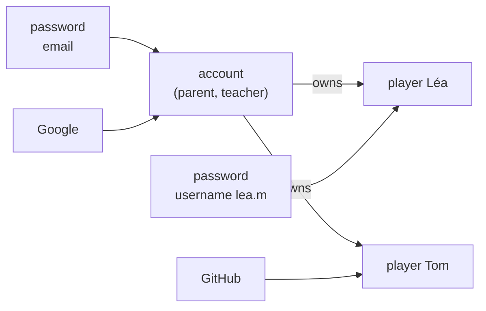

# Authentication

Since version 4.0, the app needs a sign-in. This document covers the model,
how sessions and cookies work, how to set up Google, Microsoft, GitHub or any
OpenID Connect provider, and how passkeys and email links will fit in.

- [Model](#model)
- [Ways to sign in](#ways-to-sign-in)
- [Sessions and cookies](#sessions-and-cookies)
- [Protection against abuse](#protection-against-abuse)
- [Providers](#providers)
- [Upgrading from 3.x](#upgrading-from-3x)
- [Adding passkeys and email links](#adding-passkeys-and-email-links)
- [Code](#code)

## Model



- **Account:** an adult (parent, teacher). It owns players, sees all their results, creates and deletes players, and manages every way to sign in.
- **Player:** as before, a child with their results. A player belongs to one account. Two accounts can each have a player called *Léa*.
- **Sign-in method** (table `credentials`): a password, or an identity at a provider. It is attached either to the account, or to one player.
  - **Account method:** signs in as the account.
  - **Player method:** signs in as that player only. That session sees one player, cannot switch, create or delete players, and has no Account page.

An account may have several methods: for example a password plus Google. The
last method of an account cannot be removed. Player methods can always be
removed, since the account keeps control.

## Ways to sign in

| Method | Status | Identifier |
|---|---|---|
| Email and password | **available** | Email of the account, or username of a player |
| Google, Microsoft, GitHub | **available** when configured | Provider's user id |
| Any OpenID Connect provider | **available** when configured | Provider's user id |
| Passkeys (WebAuthn) | prepared | See [below](#adding-passkeys-and-email-links) |
| Email link (magic link) | prepared | See [below](#adding-passkeys-and-email-links) |

### Passwords

- **Rules:** 10 to 200 characters, no other composition rule (current NIST guidance). Unicode is normalised (NFKC) so the same phrase typed on another keyboard matches.
- **Storage:** scrypt with N = 2¹⁵, r = 8, p = 1, a 16-byte random salt and a 32-byte key, stored as `scrypt$N$r$p$salt$hash`. The parameters are in the string, so they can be raised later without invalidating existing passwords.
- **Unknown accounts:** a sign-in with an unknown identifier still computes a hash, so the response time does not reveal which emails have an account.
- **Changing a password** signs out the account's other devices.
- **Players' usernames:** 3 to 30 characters among `a–z 0–9 . _ -`. They share one namespace with emails, which always contain `@`, so the sign-in field takes either.

### Providers

The flow is OAuth 2.0 authorization code with PKCE (S256) and a `state`:

1. `GET /api/auth/oauth/<id>/start` stores `state`, the PKCE verifier and the intent in `auth_flows`, sets a short `cc_oauth` cookie with the same `state`, and redirects to the provider.
2. The provider sends the browser back to `/api/auth/oauth/<id>/callback?code=…&state=…`.
3. The server checks that `state` matches the cookie and an unused, unexpired flow (10 minutes, single use), exchanges the code with the verifier, and reads the user from the provider's userinfo endpoint.
4. Depending on the intent:
   - **`login`:** signs in the account or player linked to that identity. An unknown identity creates an account, if registration is open.
   - **`link`:** adds the identity to the signed-in account.
   - **`link-player`:** adds it to one of the account's players.
5. The browser is sent to `/?auth=signed_in|signed_up|linked`, or `/?auth_error=<code>`, and the app shows the message.

**No takeover by email.** If a provider identity is unknown but its email
already belongs to an account, the app does **not** link them: it answers
*email_in_use*. Linking needs the owner to be signed in to the account and use
*Link* on the Account page. Otherwise anyone controlling an email at some
provider could enter an existing account.

**Emails** from a provider are recorded only when the provider says they are
verified. Microsoft does not say so, so its emails are never trusted.

## Sessions and cookies

A session is a random 256-bit token, sent to the browser in a cookie. The
database stores only its SHA-256, so a copy of the database does not contain
usable sessions.

| Cookie | Content | Attributes |
|---|---|---|
| `cc_session`, or `__Host-cc_session` with HTTPS | session token | `HttpOnly`, `SameSite=Lax`, `Path=/`, `Secure` with HTTPS, expires with the session |
| `cc_oauth` | `state` of a provider sign-in in progress | `HttpOnly`, `SameSite=Lax`, 10 minutes |

- **Lifetime:** `SESSION_DAYS` (30 by default) after the last use. The expiry is extended at most once an hour, to avoid a database write on every request.
- **Signing in** replaces any session the browser had (no session fixation).
- **Signing out** deletes the session on the server, not only the cookie. *Sign out other devices* deletes all the account's sessions except the current one, including those of its players.
- **Expired sessions** are purged at startup and every hour.
- **`__Host-` prefix:** with HTTPS, the browser accepts the cookie only if it is `Secure`, has `Path=/` and no `Domain`. This prevents a sub-domain from setting or overwriting it.
- **The page's JavaScript cannot read the session** (`HttpOnly`). The app asks `GET /api/auth/session` who is signed in.

## Protection against abuse

- **Cross-site requests:** every request that changes something (anything but `GET`, `HEAD`, `OPTIONS`) is refused with `403 cross_site` when either holds:
  - The browser marks it `Sec-Fetch-Site: cross-site`.
  - Its `Origin` is neither `PUBLIC_URL` nor the server's own address.

  Together with `SameSite=Lax`, this blocks CSRF without tokens in forms. `GET` routes never change data, apart from the provider start and callback, which are protected by `state`.
- **Rate limiting** (in memory, per server process):
  - 100 sign-in and sign-up attempts per client address in 15 minutes (`AUTH_ATTEMPTS_PER_ADDRESS`).
  - 10 failures per identifier in 15 minutes, which stops guessing one account's password from many addresses.

  The response is `429 too_many_attempts`. Behind a reverse proxy, set `TRUST_PROXY=true` so the address comes from `X-Forwarded-For`, otherwise every visitor shares the proxy's address.
- **Data scope:** every data route reads from the session which players it may touch. Another account's player answers `404`, the same as a player that does not exist.

## Providers

Each provider is switched on by setting its client id and secret in `.env`.
The sign-in screen then shows *Continue with …*. Register this redirect URI
with the provider, with the exact `PUBLIC_URL`:

```
<PUBLIC_URL>/api/auth/oauth/<id>/callback
```

The `<id>` is `google`, `microsoft`, `github`, or `OIDC_ID` for the generic
provider. For example: `https://calcul.example.ch/api/auth/oauth/google/callback`.

### Google

1. [Google Cloud console](https://console.cloud.google.com/) › *APIs & Services* › *OAuth consent screen*: configure it (external, app name, support email). The scopes `openid`, `email` and `profile` need no review.
2. *Credentials* › *Create credentials* › *OAuth client ID* › *Web application*. Add the redirect URI.
3. Set `GOOGLE_CLIENT_ID` and `GOOGLE_CLIENT_SECRET`.

### Microsoft

1. [Microsoft Entra admin center](https://entra.microsoft.com/) › *App registrations* › *New registration*.
2. Supported account types: personal and work accounts for the widest use. Redirect URI: platform *Web*, the URI above.
3. *Certificates & secrets* › *New client secret*. Copy the **value**, not the id.
4. Set `MICROSOFT_CLIENT_ID` (the *Application (client) ID*) and `MICROSOFT_CLIENT_SECRET`. `MICROSOFT_TENANT` selects who may sign in:
   - `common`: everyone (default).
   - `consumers`: personal accounts only.
   - `organizations`: work and school accounts only.
   - A tenant id: one organisation.

### GitHub

1. GitHub › *Settings* › *Developer settings* › *OAuth Apps* › *New OAuth App*.
2. *Authorization callback URL*: the URI above.
3. *Generate a new client secret*.
4. Set `GITHUB_CLIENT_ID` and `GITHUB_CLIENT_SECRET`.

GitHub is plain OAuth 2.0, not OpenID Connect. The app reads `/user` for the
id and name, and `/user/emails` for the primary verified email.

### Any OpenID Connect provider

Keycloak, Authentik, Zitadel, Auth0, GitLab, Infomaniak and most identity
services publish `/.well-known/openid-configuration`. The app reads the
endpoints from it.

| Variable | |
|---|---|
| `OIDC_ISSUER` | Issuer URL, without `/.well-known/…` |
| `OIDC_CLIENT_ID`, `OIDC_CLIENT_SECRET` | Confidential client, authorization code flow, PKCE allowed |
| `OIDC_ID` | Id in URLs and the database (default `oidc`). **Do not change it later:** linked identities are stored under it. |
| `OIDC_NAME` | Name on the button |
| `OIDC_SCOPES` | Default `openid email profile` |
| `OIDC_TRUST_EMAIL` | `false` to ignore the provider's `email_verified` |

A second generic provider, or another named one, is a few lines in
`server/auth/providers.ts`: copy `google()` with the provider's endpoints, and
add it to `providersFromEnv`.

### Local testing

`tests/e2e/mock-oidc.ts` is a strict OpenID provider for tests: it checks the
client secret, the redirect URI, single-use codes and PKCE. To try provider
sign-in without a real account:

```sh
npx tsx tests/e2e/mock-oidc.ts      # http://localhost:8798, client test-client / test-secret
```

```ini
OIDC_ISSUER=http://localhost:8798
OIDC_CLIENT_ID=test-client
OIDC_CLIENT_SECRET=test-secret
OIDC_NAME=Mock ID
OIDC_ID=mock
```

Its consent page lets you choose the user id, email and name.

## Upgrading from 3.x

Migration `006_accounts` adds the tables. Existing players have no owner
until the **first account is created**: that account receives all of them,
with their results. So after upgrading:

1. Open the app and create the account that should own the existing players.
2. If others should not create accounts, set `REGISTRATION=closed` and restart. They sign in with methods you add for them, or as players.

Player names stay unique per account, ignoring case.

## Adding passkeys and email links

The schema is ready for both: `credentials.type` already accepts `passkey`
and `email_link`. No migration is needed.

### Passkeys (WebAuthn)

| Column | Use |
|---|---|
| `type` | `passkey` |
| `provider` | `''` |
| `subject` | Credential id, base64url |
| `secret` | Public key (COSE, base64url) and the signature counter, as JSON |
| `label` | Name given by the user (*MacBook*, *Phone*) |
| `player_id` | Set for a player's own passkey |

Plan:

1. Add [`@simplewebauthn/server`](https://simplewebauthn.dev/) (server) and `@simplewebauthn/browser`.
2. **Registration**, signed in, from the Account page:
   - `POST /api/auth/passkeys/options` stores the challenge in `auth_flows` (`state` = challenge id) and returns the creation options.
   - `POST /api/auth/passkeys` verifies the response and inserts the credential.
3. **Sign-in:**
   - `POST /api/auth/passkeys/login/options` returns a challenge.
   - `POST /api/auth/passkeys/login` verifies the assertion, updates the counter, then calls `startSession` as the password route does.
4. The relying party id is the host of `PUBLIC_URL`. Passkeys need HTTPS, except on `localhost`.

### Email links

| Column | Use |
|---|---|
| `type` | `email_link` |
| `subject` | The email address |
| `secret` | Unused |

Plan:

1. Add an SMTP setting (`SMTP_URL`, `MAIL_FROM`) and a mail sender, for example `nodemailer`.
2. `POST /api/auth/email-link {email}`:
   - Store a random token's SHA-256 in `auth_flows` (intent `login`, 15 minutes).
   - Mail `<PUBLIC_URL>/api/auth/email-link/<token>`.
   - Always answer `204`, whether or not the account exists.
3. `GET /api/auth/email-link/<token>` takes the flow (single use), finds or creates the account, starts the session and redirects to `/?auth=signed_in`.
4. Apply the per-address limit and a per-email limit to sending.

`auth_flows.intent` would need `email_link` added to its `CHECK`, which is a
migration on PostgreSQL. On SQLite it means rebuilding that table, which has
no dependants.

## Code

| File | Role |
|---|---|
| `server/auth/config.ts` | Settings from the environment |
| `server/auth/passwords.ts` | scrypt hashing, password rules |
| `server/auth/sessions.ts` | Tokens, cookies, starting, reading and ending sessions |
| `server/auth/providers.ts` | Google, Microsoft, GitHub, generic OpenID; code exchange |
| `server/auth/store.ts` | SQL for accounts, methods, sessions, flows |
| `server/auth/rate-limit.ts` | Sliding-window counter |
| `server/auth/middleware.ts` | Origin check, session loading, `requireSession`, `requireAccount` |
| `server/auth/routes.ts` | `/api/auth/*` |
| `src/auth.ts` | Sign-in screen and Account page |
| `src/auth-i18n.ts` | Their texts, and error messages |
| `tests/e2e/auth.spec.ts` | 9 browser tests, with `tests/e2e/mock-oidc.ts` |

The endpoints are listed in [API › Authentication](api.md#authentication).
