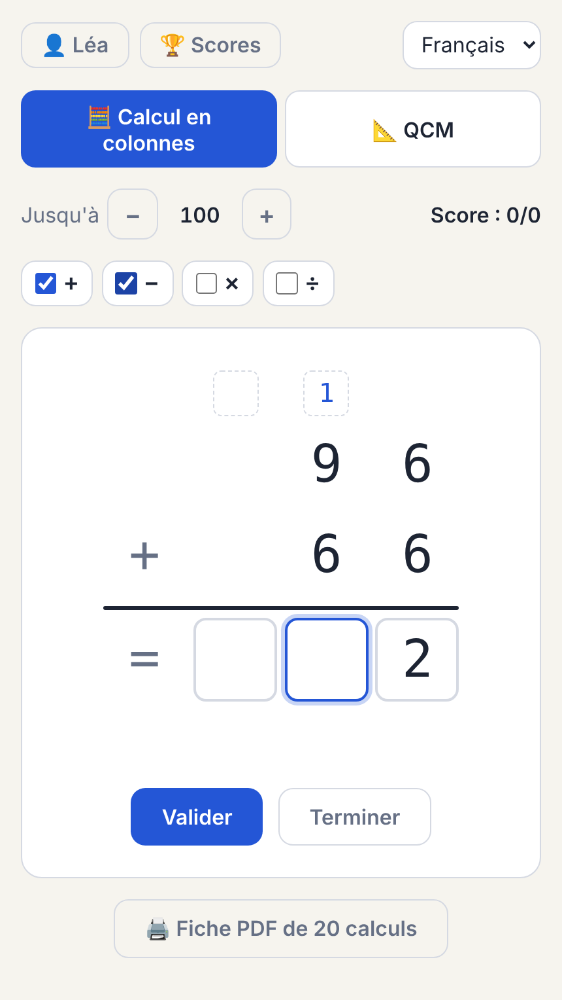
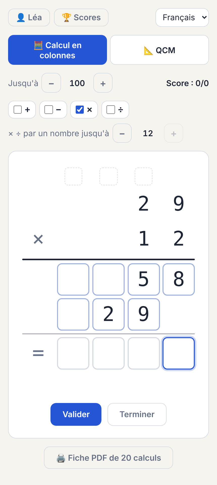
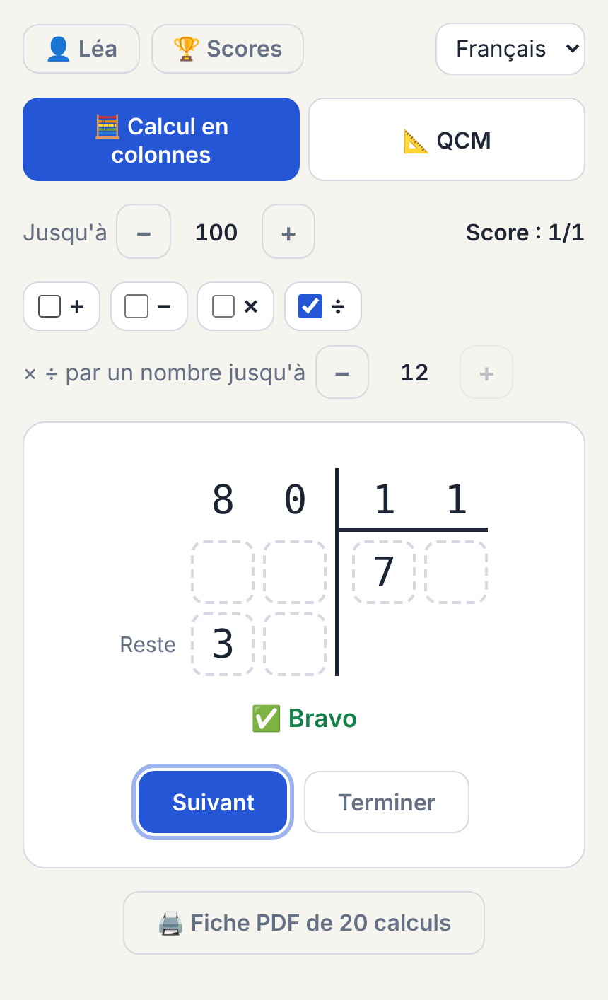
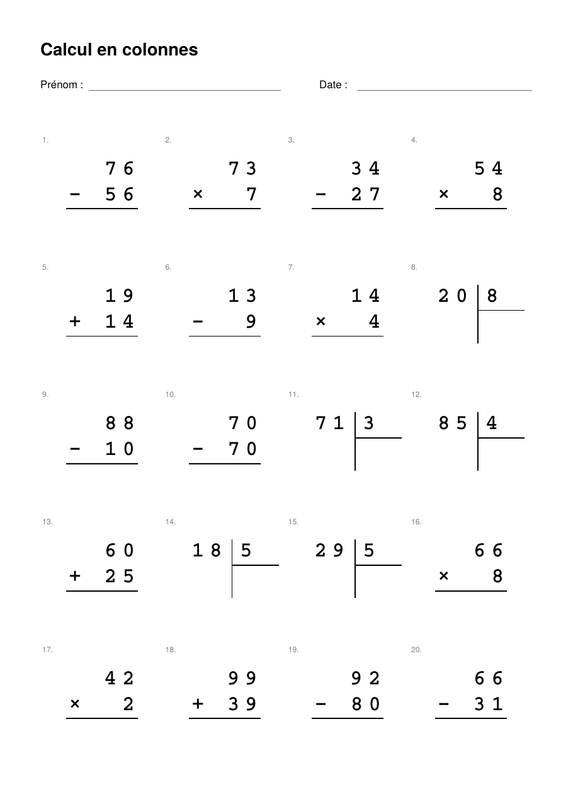
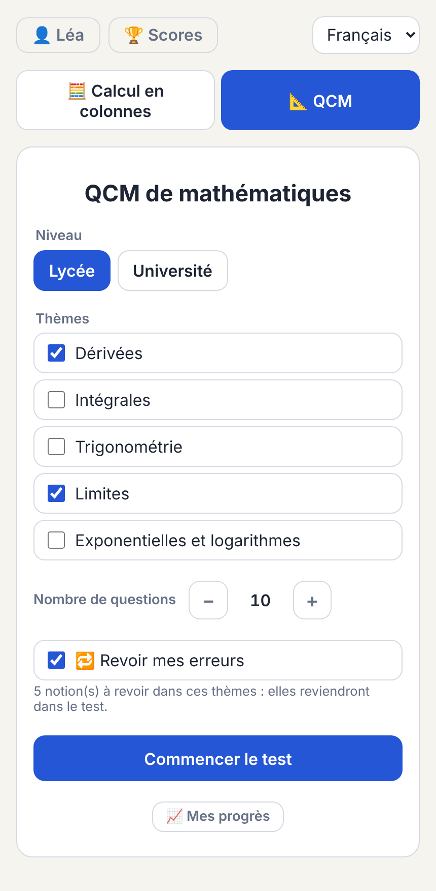
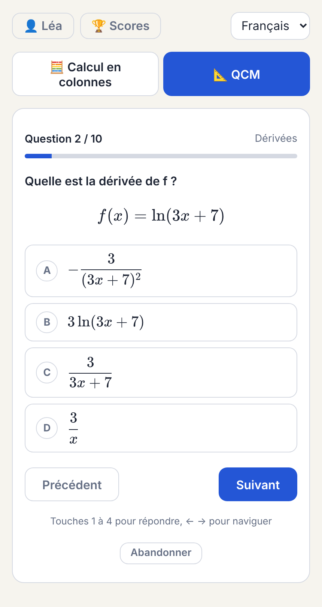
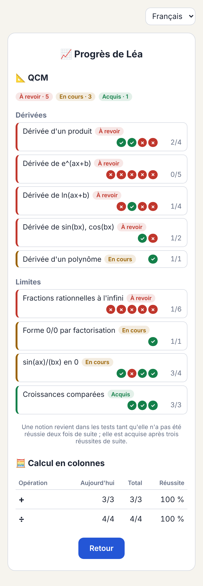

# User guide

This guide is for the adults setting the app up for children or students. It
describes every screen, every setting and the keyboard shortcuts.

- [Signing in](#signing-in)
- [Account page](#account-page)
- [Players](#players)
- [Home page](#home-page)
- [Column arithmetic](#column-arithmetic)
- [Printable worksheet](#printable-worksheet)
- [Multiple-choice tests](#multiple-choice-tests)
- [Physical chemistry](#physical-chemistry)
- [Linux](#linux)
- [Chemical equations](#chemical-equations)
- [Progress and review of mistakes](#progress-and-review-of-mistakes)
- [Vocabulary](#vocabulary)
- [Discover](#discover)
- [Physics](#physics)
- [Astronomy](#astronomy)
- [Mathematical curiosities](#mathematical-curiosities)
- [Chemistry and biology labs](#chemistry-and-biology-labs)
- [Scores](#scores)
- [Language](#language)
- [On a phone or tablet](#on-a-phone-or-tablet)
- [What is stored where](#what-is-stored-where)

## Signing in

A first visit opens on a short presentation of the app, with *Créer un compte*
and *J'ai déjà un compte*. A browser that has been signed in before opens
directly on **Connexion / Iniciar sesión / Sign in**. Both forms have their own
address, to bookmark or send: `/#sign-in` and `/#sign-up`; the presentation
is at `/#about`.

- **Create an account:** *Pas encore de compte ? Créer un compte*. Name, email and a password of at least 10 characters. A short sentence is easier to remember than a complicated word.
- **Sign in:** with the account's email, or with a player's username, and the password.
- **With a provider:** *Continuer avec Google* (or Microsoft, GitHub…) when the server offers it. The first time, it creates an account.
- **Stay signed in:** a browser stays signed in for 30 days after its last use.

**An account and its players.** The account belongs to an adult. It holds the
players: the account sees all of them and their results, and manages them.
A child can also get a sign-in of their own (see below): they then see only
their own exercises and results, and cannot switch to another player.

If the app was used before sign-in existed, the **first account created**
receives all existing players and their results.

**An email already used.** Signing in with a provider whose email already has
an account here is refused. Sign in to that account first, then link the
provider from the Account page. This prevents someone from entering an account
just by using the same email elsewhere.

## Account page

The ⚙️ button at the top opens the Account page (not shown in a player's own
session).

- **Ways to sign in:** the password and linked providers, with the date of last use.
  - **Link Google / GitHub…** adds a provider: then either the password or the provider signs in.
  - **Remove** takes one away. The last one cannot be removed.
- **Change password** (or **Add a password** for an account created through a provider). Changing it signs out every other device.
- **Players**, one block each:
  - **Activités affichées:** untick what the player should not see on their home page, for example the column arithmetic for an older child. It is saved at once, for every device. New books show until unticked.
  - **Partage:** *Créer un code de partage* gives a code such as `K7QF2-9XMRA`, valid a week and once, for another account (the other parent, a teacher). The accounts that see the player are listed, each with *Retirer*.
  - **Own sign-in:**
    - **Username and password:** the child signs in with the username, for example `lea.m`. Saving again replaces them and signs the child out.
    - **Link a provider:** for an older child with their own Google or Microsoft account.
    - **Remove:** their sign-in stops working at once.
  - A player another account shares with this one shows only *Partagé par …* and **Ne plus voir …**: its activities, sharing and sign-in are its owner's.
- **Ajouter un joueur partagé:** type the code received from the player's account.
- **Devices:**
  - **Sign out other devices:** for a lost phone or a shared computer.
  - **Sign out:** this device only.
- **Vos données:**
  - **Télécharger mes données:** everything stored about the account and its players, as a JSON file.
  - **Supprimer mon compte:** after typing the account's name, deletes the account, its players with all their results, its sign-ins and shares, at once and for good.
  - **🔒 Confidentialité:** what is stored, who sees it, for how long.
- **👪 Famille et amis** (the owner's account only, the first one on the server):
  - **Invitations:** *Créer une invitation*, with a note saying for whom, gives a link valid once for two weeks; send it, and it opens the sign-up form. The list says which were used, and by whom.
  - **Ce que voient les autres comptes:** each vocabulary book, and the written physical chemistry questions: *Moi seulement* or *Tous les comptes*. A book you own stays *Moi seulement*; the kanji (open licences) can be shared.
  - **Avis reçus:** what the others sent with *💬 Envoyer un avis*.

In a player's own session, the 🚪 button at the top signs out.

**At the bottom of the home page:** *💬 Envoyer un avis* (a few lines to the
owner of the server), the version with *Nouveautés* (what each release brought,
in a few lines), *🔒 Confidentialité*, and *🧭 Visite guidée* (the
[guided tour](#guided-tour)). After an update, the home page shows
once what is new.

## Guided tour

The first time an account signs in, the app opens the **guided tour**
(`#tour`) before anything else: a few pages on how Luma is laid out, each with
the labels of the buttons it talks about.

| Page | What it shows |
|---|---|
| 👋 Bienvenue | What Luma trains; the tour can be found again |
| 👥 Un compte, plusieurs joueurs | *Qui joue ?*, the 👤 chip, *Scores*, a player's own login and sharing in ⚙️ |
| 🏠 La page d'accueil | The groups of activities, the badges of what is due |
| 📝 Les tests | Level, topics, number of questions, *4 choix* or *Au clavier*, keys 1 to 4 and ← →, the corrections |
| 📈 Révisions et progrès | Missed kinds come back; *📈 Mes progrès*, *🗂️ Mes tests*, *Refaire ce test* |
| 🗣️ Les langues | *Apprendre* and *Réviser*, spaced review, the scripts |
| 🔭 Découvrir | The interactive labs |
| ⚙️ Le compte et les données | *Activités affichées*, export and deletion, *🔒 Confidentialité*, *💬 Envoyer un avis*, the language |
| 🚀 C'est parti | Where to start |

- **Moving:** *Suivant →* and *← Précédent*, or the ← → keys; the dots show where you are. *Commencer* on the last page closes it.
- **Skipping:** *Passer la visite*, a button of the top bar, or the browser's back button. The tour counts as seen and does not open by itself again, on any device.
- **Again, later:** *🧭 Visite guidée* at the bottom of the home page opens it on its first page, at any time.
- **A player's own login:** the player gets the tour once on their own, without the pages on players and the account, and with a page on their own login and 🚪.
- **Accounts from before 6.23:** not shown the tour; the link is there for them too.

The tour follows the language chosen at the top right, and stays on its page
when the language changes.

## Players

After signing in, the app shows **Qui joue ? / ¿Quién juega? / Who's playing?**.

- **Choose a player:** click their name.
- **Add a player:** type a first name (20 characters at most) and press *Ajouter*. Names must be unique within the account, ignoring case.
- **Remembered:** the browser remembers the last player, so the app reopens on their work.
- **Switch player:** click the 👤 name chip at the top left.

A player can be deleted from the [Scores](#scores) screen, which also deletes
all their results. A shared player, marked *partagé*, is only removed from
this account's list: the player and their results stay with their own
account.

## Home page

After choosing a player, and at each visit, the app opens on the player's
home page: **Que fait-on, Léa ?**

| Group | Activities | Shows |
|---|---|---|
| Mathématiques | 🧮 Calcul en colonnes, 📐 QCM, ∫ Analyse | For the QCM and calculus, how many kinds of question are to review |
| Langues | 💬 one per vocabulary book: *Vocabulaire espagnol*, *Vocabulaire anglais*…; 📚 one per language with several books (*Vocabulaire allemand*: Collins, Lernwortschatz, Nietzsche) | Words due today, *À jour*, or the book's number of words if not started |
| Exercices des livres | ✏️ one per workbook (*Grammar in Use*, *Vocabulary Advanced*…) | Exercises corrected and score, or the book's number of exercises |
| Sciences | ⚗️ Chimie physique | Kinds of question to review, counted apart from the QCM |
| Informatique | 🐧 Linux, 🗄️ SQL, 🦀 Rust, 🔷 TypeScript, ⚛️ React, ☁️ Google Cloud | Kinds of question to review, for each |
| Économie | 🏛️ Économie publique | Kinds of question to review |
| Découvrir | 🎲 Le labo des probabilités, 🪙 Pile ou face, 🧩 Grilles logiques | |
| Physique | 🏀 Lancer une balle, ⏱️ Le pendule, 🔍 Les lentilles, 💡 Les circuits | |
| Astronomie | 🌓 Les phases de la Lune, 🌍 Les saisons, 🌑 Les éclipses, 🪐 Les orbites des planètes | |
| Curiosités mathématiques | ❄️ Le flocon de Koch, 🌀 L'ensemble de Mandelbrot, 🎲 Le jeu du chaos, 🦋 L'attracteur de Lorenz, 🐇 De l'ordre au chaos | |
| Chimie et biologie | ⚗️ Équations chimiques, 🧬 Construire des molécules, 🫛 Les pois de Mendel, 🦠 Pourquoi les cellules sont petites, 🐇 Lièvres et lynx | For the test, kinds of question to review |

Click an activity to open it. Every activity has *← Accueil* at the top to
come back.

**On a large screen** the page uses the width: subjects with one or two
activities sit side by side, and a group's cards fill its row. On a phone the
groups follow one another.

**📈 Mes progrès**, next to the greeting, opens the overview of the player's
progress (see [Progress](#progress-and-review-of-mistakes)).

## Column arithmetic

Tab **🧮 Calcul en colonnes**.

### Settings

| Setting | Values | Effect |
|---|---|---|
| Operations `+ − × ÷` | at least one ticked | Each exercise is drawn among the ticked operations. |
| *Jusqu'à* (up to) | 20 to 100 by 10, then 200 to 1000 by 100 | Largest value of the top number, or of the dividend. |
| *× ÷ par un nombre jusqu'à* | 2 to 12 | Largest multiplier and divisor. Shown when `×` or `÷` is ticked. |

Settings are remembered by the browser. The score shown at the top right
counts the current sitting; the saved totals are on the [Scores](#scores)
screen.

### How exercises are built

- **Addition and subtraction:** the top number is between 10 and the maximum, the bottom number between 1 and the top number. Subtractions never go negative.
- **Multiplication:** the multiplier is drawn first, between 2 and its limit, then the top number between 10 and the maximum.
- **Division:** built from its solution. A divisor between 2 and its limit, a whole quotient and a remainder smaller than the divisor are drawn first; the dividend is then divisor × quotient + remainder, never above the maximum.

### Writing the answer

The cursor starts on the **units**. Each digit typed moves the cursor one
column left, to the tens, then the hundreds, as on paper.

| Key | Effect |
|---|---|
| digit | Writes the digit and moves to the next column |
| `Backspace` | On an empty box, goes back one column and erases it |
| `←` `→` | Moves between columns |
| `↑` | Opens the **carry** box above the current column; writing the carry returns the cursor to the answer |
| `↓` | From a carry box, back to the answer |
| `Enter` | Checks the answer; pressed again, goes to the next exercise |

Anything other than a digit is ignored. **Carries are scratch work and are
never marked.** An empty answer, or a gap between two digits, gets a message
and does not count as an attempt.

### Multiplication by a two-digit number

With a multiplier of 10 or more, three result lines appear:

1. The first partial product (top number × units digit).
2. The second partial product (top number × tens digit), shifted one column left.
3. The total, under a thin rule.

The cursor starts on the units of the first line. `Enter` on a partial line
moves to the next line, and from the second line to the total; `↑` and `↓`
move between lines in the same column. **Only the total is marked**: the
partial lines are the child's working.

### Euclidean division

The layout is the French and Spanish one: the dividend on the left, the
divisor on the right above a horizontal line, and the quotient below that
line. A vertical bar separates the two sides.

- **Quotient:** written left to right. The cursor starts there.
- **Working lines:** dashed boxes under the dividend, one line per step of the division (one per digit of the quotient), for partial dividends and remainders. They are not marked.
- **Remainder:** on the last line, marked *Reste / Resto*. It must be written even when it is 0. `Enter` with the remainder still empty asks for it and moves the cursor there.

The answer is right only if both quotient and remainder are right.

## Printable worksheet

**🖨️ Fiche PDF de 20 calculs** opens a one-page A4 PDF in a new tab:

- 20 new operations, drawn among the ticked operations within the current ranges.
- A first-name and date line at the top.
- Room above each operation for carries.

The sheet is in the chosen language. If the browser blocks the new tab, the
PDF downloads instead. Worksheets are not recorded and there is no answer key.

## Multiple-choice tests

Tab **📐 QCM** (**Test** in Spanish).

### Settings

| Setting | Values |
|---|---|
| Level | *Lycée / Bachillerato*, or *Université / Universidad* |
| Topics | By group. **Analyse:** reading graphs, function study, sequences, derivatives, integrals, limits, exponentials and logarithms, trigonometry, differential equations, and at university series and functions of two variables. **Algèbre:** complex numbers, matrices and systems. **Géométrie:** vectors, planes and distances in space. **Probabilités:** the binomial law, trees and Bayes' formula, counting, expectation, and at university the Poisson, exponential and normal laws. Only the topics of the chosen level are shown; at least one |
| Number of questions | 5, 10, 15 or 20 |
| Réponses | *4 choix*, or *Au clavier*: questions whose answer is a number are answered by typing it (see [typed answers](#typed-answers)) |
| 🔁 Revoir mes erreurs | On by default; see [review of mistakes](#progress-and-review-of-mistakes) |

The topics in a test are taken in turn, so a test covers all the chosen ones
evenly. The [question generators](question-generators.md#the-110-kinds-of-question)
page lists what each topic and level contains.

### Taking a test

One question at a time with four options. A progress bar fills as questions
are answered.

| Key | Effect |
|---|---|
| `1`–`4` or `A`–`D` | Chooses an option |
| `→` / `←` | Next / previous question |
| `Enter` | Next question; on the last one, finishes the test |

Answers can be changed until the test is finished. Finishing with blank
answers asks for confirmation; a blank counts as wrong. *Abandonner* drops the
test without saving it. Changing the language during a test keeps the test.

**Graph questions** (*Lecture graphique*) show a curve and ask for another:
which curve is f′, which is g(x) = f(x − 2), which plane has this equation.
The four options are drawn two by two and named by their letter only; their
formulas appear in the corrections.

#### Typed answers

With *Réponses: Au clavier*, a question whose answer is a number shows a field
instead of four options; the others keep their options. Under the field, the
app shows what it reads (≈ 2,0944) as you type, and a row of keys adds the
symbols phones hide: π, √, /, ^, −, e and brackets. `Enter` goes on.

| Typed | Read as |
|---|---|
| `7/45`, `2π/3`, `2pi/3`, `√2`, `sqrt(2)/2`, `e^2 − 1`, `ln 3`, `3√2` | an exact value |
| `1,05` or `1.05` | a rounding, right to its last digit: π/3 = 1.0472 is accepted, `1` or `1,0` is not |

A rounding is never allowed more than 0.6 % of the answer. A value typed
that matches a wrong option counts as that option, and its mistake is named
in the corrections, as when it is picked. The server reads the text again
and decides.

### Results

The mark comes first, then each question with the answer chosen, the right
answer and a short explanation with its formula. For a wrong answer, the
**mistake** it stands for is named, for example *Dérivée de l'intérieur
oubliée* (inner derivative forgotten) or *Solution oubliée* (solution missed).
The buttons:

- **Nouveau test:** a new test with the same settings.
- **Refaire le même test:** exactly the same questions again.
- **Changer les réglages:** back to the settings.
- **📈 Mes progrès:** the [progress page](#progress-and-review-of-mistakes).

The result is saved by the server, which recomputes the mark itself. If the
server cannot be reached, the page says *Résultat non enregistré*.

## Physical chemistry

Activity **⚗️ Chimie physique** (*Química física*, *Physical chemistry*), in
the *Sciences* group: multiple-choice tests on *Atkins' Physical Chemistry*,
12th edition. Settings, keys, typed answers and results work as for the
[QCM](#multiple-choice-tests), with two levels:

| Niveau | Questions |
|---|---|
| *Fondamental* | Calculations and concept questions of the course |
| *Avancé* | Reasoning and derivations, a step beyond the course: a free expansion of a van der Waals gas, why $pV^{\gamma}$ needs a reversible change, what a negative expansion coefficient does to entropy. No calculations. |

| Topic | Atkins | Content |
|---|---|---|
| 1 · Les gaz | Focus 1 | Perfect gas, kinetic model, real gases |
| 2 · Premier principe | Focus 2 | Work, heat, internal energy, enthalpy, thermochemistry, adiabatic changes |
| 3 · Deuxième et troisième principes | Focus 3 | Entropy, its measurement, Helmholtz and Gibbs energies, the fundamental equations |
| 4 · Transformations physiques | Focus 4 | Phase diagrams, the phase rule, the Clapeyron and Clausius–Clapeyron equations |
| 5 · Les mélanges | Focus 5 | Partial molar quantities, ideal and dilute solutions, colligative properties, binary and ternary phase diagrams, activities, ionic strength |
| 6 · L'équilibre chimique | Focus 6 | K and ΔrG°, Le Chatelier and van 't Hoff, cells, the Nernst equation, electrode potentials |
| 7 · Théorie quantique | Focus 7 | Photons and black bodies, the photoelectric effect, de Broglie, uncertainty, the particle in a box, vibration and rotation, tunnelling |
| 8 · Structure atomique et spectres | Focus 8 | Hydrogenic atoms and their spectra, orbitals and nodes, many-electron atoms, term symbols and spin–orbit coupling |
| 11 · Spectroscopie moléculaire | Focus 11 | The Beer–Lambert law and linewidths, rotational and Raman spectra, vibrations and anharmonicity, normal modes, electronic spectra, lasers |
| 12 · Résonance magnétique | Focus 12 | Nuclear and electron spins in a field, chemical shifts and couplings, multiplets, relaxation and exchange, pulse techniques, EPR g-values and hyperfine structure |
| 13 · Thermodynamique statistique | Focus 13 | The Boltzmann distribution, partition functions and symmetry numbers, mean energies and equipartition, the canonical ensemble, heat capacities, the Sackur–Tetrode and residual entropies, equilibrium constants from partition functions |
| 17 · Cinétique chimique | Focus 17 | Rate laws and orders, integrated laws and half-lives, relaxation, the Arrhenius equation, mechanisms and the steady state, enzymes, polymers, photochemistry |
| 18 · Dynamique réactionnelle | Focus 18 | Collision theory, diffusion control, transition-state theory and activation parameters, the kinetic salt and isotope effects, potential energy surfaces, electron transfer |

A test mixes two kinds of question:

- **Calculations,** generated with new data each time: the pressure of a gas, the work of an expansion, an entropy of heating, ΔG at a temperature, a vapour pressure, a freezing-point depression, an equilibrium constant, a cell potential. Data are given to three significant figures and the options carry their unit; the wrong options are the usual slips, such as °C used for K, kJ mixed with J, or C_p taken for C_V. With *Au clavier*, the number is typed in the unit shown, unless the options are too close to tell apart by typing. Equilibrium constants, which span powers of ten, are always chosen from the four options.
- **Concept questions,** written from the book. Each shows its section (*Atkins 2B.1*) and, in the corrections, why the answer is right. They are in the app's language: French, Spanish or English.

In the progress page, each Topic of the book is one kind of question per
level (*Notions 2B – L'enthalpie*, *Avancé 2B – L'enthalpie*), next to the
calculations.

**⚑ Signaler cette question.** Under each question of the corrections: a
question that looks wrong or unclear can be reported, with a note. Reports
are read with `npm run quiz:flags` (see [Question bank](question-bank.md#flags)).

The concept questions are imported on the server from a file kept by its
administrator. Without it, the page says so and tests hold calculations
only.

## Linux

Activity **🐧 Linux**, in the *Informatique* group (*Informática*,
*Computing*): multiple-choice tests on the command line. Settings, keys,
typed answers and results work as for the [QCM](#multiple-choice-tests);
there is one level.

| Topic | Content |
|---|---|
| Fichiers et permissions | `cd`, `ls`, links, `find`, `chmod` and `umask`, `tar` and `zip` |
| Traitement de texte | `grep`, `sed`, `awk`, `cut`, `sort`, `uniq`, pipelines |
| Le shell | Redirections, expansions, conditions and loops, variables |
| Processus et services | `ps`, signals, jobs, `systemctl`, `cron` and `at` |
| Système, disques, paquets | `df`, `du`, `mount`, users and groups, `apt` and `dnf` |
| Réseau et SSH | `ip`, `ss`, `curl`, `rsync`, `ssh`, `dig` |
| Scripts bash | Tests, loops and `read`, functions, arguments and `getopts`, arrays, `${f%.*}` and its kin |
| Git | Staging and commits, branches, merge and rebase, undoing (`restore`, `revert`, `reset`, `reflog`, `stash`), remotes |
| Vim | Modes, saving and quitting, moving, operators and text objects, search and `:s`, `:g` |
| Outils à installer | `rg`, `fd`, `fzf`, `bat`, `jq`, `htop`, `tmux`, `hyperfine`, `shellcheck`, `mtr`, `nmap`… |

Commands are shown as code. A question about a command that a default
install does not have shows a *📦* badge with the package name, and its
correction says how to install it on Debian and Ubuntu, Fedora and macOS.

The topics come in three groups: *La ligne de commande*, *Scripts, git et
vim*, and *Outils à installer*.

Some questions are generated each time: `chmod` modes in both directions,
the modes left by a `umask`, when a crontab line runs, and what a command
prints: a `sed` substitution or an `awk` program on a line of text, or
bash's `${f%.*}` on a file name. An octal mode can be typed with
*Au clavier*.

## SQL

Activity **🗄️ SQL**, in the *Informatique* group, next to Linux:
multiple-choice tests on SQL and databases. Settings, keys, typed answers
and results work as for the [QCM](#multiple-choice-tests); there is one
level.

| Group | Topic | Content |
|---|---|---|
| Le langage SQL | Lire : filtres, NULL, tri | `WHERE`, `BETWEEN`, `LIKE`, `DISTINCT`; NULL and three-valued logic; `ORDER BY`, `LIMIT`, paging; `CASE`, `CAST`, division |
| | Agréger et regrouper | `COUNT`, `SUM`, `AVG`, `string_agg`; `GROUP BY`, `HAVING`; window functions |
| | Jointures et sous-requêtes | inner, outer and self joins; subqueries, `EXISTS`, `WITH`; `UNION`, `EXCEPT` |
| | Modifier : données, schéma, transactions | `INSERT`, `UPDATE`, `DELETE`; types, keys and constraints; transactions and isolation; indexes |
| PostgreSQL, SQLite, MySQL | PostgreSQL et psql | `\d`, `\c`, `\x`, `\copy`; `RETURNING`, `ON CONFLICT`, identity columns, JSONB; `pg_dump`, roles, `EXPLAIN ANALYZE`, `VACUUM` |
| | SQLite et sqlite3 | `.tables`, `.schema`, `.import`, `.backup`; type affinity, `STRICT`, rowid; `PRAGMA foreign_keys`, WAL, locks |
| | MySQL et MariaDB | `SHOW`, `USE`, `DESCRIBE`, `\G`; `mysqldump`, accounts `'user'@'host'`; `utf8mb4`, backticks, InnoDB, `ON DUPLICATE KEY UPDATE` |
| | Bonnes pratiques | table design; SQL injection and parameters; N+1 queries, `EXPLAIN`, connection pools; backups, migrations |

Where the three engines differ, the question says so. A question on an
engine shows its client as *📦 postgresql-client*, *📦 sqlite3* or
*📦 default-mysql-client*, and its explanation ends with the install
commands.

Some questions are generated each time: two small tables, *owners* and
*pets*, with a few NULLs, and a query: *Que renvoie cette requête ?* The
wrong results are the usual slips: `>` read as `>=`, NULL compared with `=`,
OR before AND, `COUNT(*)` for `COUNT(kind)`, HAVING forgotten, a LEFT JOIN
read as an inner one. A count or an average can be typed with *Au clavier*.

## Rust

Activity **🦀 Rust**, in the *Informatique* group: multiple-choice tests on
Rust at four levels, *Débutant*, *Intermédiaire*, *Avancé* and *Expert*
(*Principiante* to *Experto*, *Beginner* to *Expert*). Settings, keys,
typed answers and results work as for the [QCM](#multiple-choice-tests).
Each level offers the topics it has:

| Level | Topics |
|---|---|
| Débutant | Bases (variables, types, `if`, `loop`, `for`), Possession (moves and copies), Structs et enums, Erreurs (panics, `Result`), Collections (`Vec`), Cargo et rustup |
| Intermédiaire | Bases (`String` and `&str`, conversions), Emprunts, Traits et génériques, L'opérateur `?`, Itérateurs et `HashMap`, Threads et canaux, Modules et tests |
| Avancé | Durées de vie, `Box`/`Rc`/`RefCell`, `dyn Trait`, Concevoir ses erreurs, Closures, `Send`/`Sync`/`Mutex`/atomiques, Features et espaces de travail, Macros |
| Expert | Mutabilité intérieure et variance, Cohérence/GAT/`?Sized`, async et tokio, `build.rs`/MSRV/CI/publication, `unsafe`, FFI |

Some questions show a short program and ask what it prints: `/` and `%` on
a negative number, `as` casts, a shadow in a block, bytes and characters,
an iterator chain, a `match`, `Option` methods, `dedup` and `sort`, the
order in which values are dropped. The wrong answers are the usual slips.
A sum printed by an iterator chain can be typed with *Au clavier*. Every
program has been compiled and run to check its answer.

## TypeScript

Activity **🔷 TypeScript**, in the *Informatique* group: multiple-choice
tests on TypeScript at four levels, *Débutant* to *Expert*, chosen as in
the Rust test. Each level offers the topics it has:

| Level | Topics |
|---|---|
| Débutant | types and inference, arrays and objects, functions, interfaces, unions, the JavaScript basics (`===`, `let`/`const`, falsy values), setting up a project |
| Intermédiaire | literal types and `as const`, overloads and `this`, classes, type guards and discriminated unions, generics, promises and async, modules |
| Avancé | closures, structural typing, control-flow analysis, utility types, mapped and conditional types, JavaScript pitfalls, strict options |
| Expert | class fields and decorators, `const` type parameters, `NoInfer`, variance and brands, where the type system is unsound, the engine (microtasks, `WeakMap`, generators), TypeScript 7 and Node's type stripping |

Some questions show a short program and ask what it logs: `sort` without a
comparator, `??` and `||`, `typeof`, the order of the event loop, closures
over `var`, floating point and rounding, shallow copies, `async` and
`await`, a class's initialization order. Every program has been
type-checked in strict mode and run to check its answer.

## React

Activity **⚛️ React**, in the *Informatique* group: multiple-choice tests on
React and the stack around it, at four levels, *Débutant* to *Expert*,
chosen as in the Rust test. The topics come in two groups, *Composants, état
et rendu* and *La pile : données, types, outils, tests*; each level offers
those it has:

| Level | Topics |
|---|---|
| Débutant | components, JSX and props, `useState`, a first effect, lists and keys, loading data and the Vite proxy, typing props, a Vite project, a first test |
| Intermédiaire | context, custom hooks and portals, designing state, effects in practice (races, keys), the rules of rendering, forms and Actions, TanStack Query, typing events and refs, Fast Refresh and the build, component tests |
| Avancé | `ref` as a prop, error boundaries, `lazy`, external stores and the URL, `useEffectEvent`, `useLayoutEffect`, `<Activity>`, the React Compiler, transitions, `use`, server components and functions, hydration, generic components, Hono's typed client, deploying, end-to-end tests |
| Expert | portals and events, the render and commit phases, tearing, Actions after `await`, `useInsertionEffect`, bailouts and `useId`, streaming and pre-rendering, React 19's types, CSP and deployments, fake timers and `act` |

Some questions show a short component and ask what the page or the console
shows once it is rendered, sometimes after clicks on its button: several
`setN` in one click, `0 &&`, default props, what a handler sees, the order of
renders and effects, batching, keys, refs, cleanups, `memo`, StrictMode,
layout effects. Every program has been type-checked and rendered with React
to check its answer.

## Google Cloud

Activity **☁️ Google Cloud**, in the *Informatique* group: multiple-choice
tests on Google Cloud at four levels, *Débutant* to *Expert*, with a focus on
identity and access and on the infrastructure. The topics come in two
groups, *Identité et accès* and *Infrastructure*:

| Level | Topics |
|---|---|
| Débutant | the resource hierarchy, IAM's vocabulary, service accounts and their keys, Secret Manager, VPC networks and implied rules, Cloud NAT, Cloud Run, Cloud Storage, gcloud and credentials, budgets |
| Intermédiaire | organisation policies, custom roles and conditions, safe policy changes, actAs and impersonation, audit logs, Shared VPC, peering, IAP, Private Google Access, MIGs, Cloud Run revisions, uniform bucket access, Terraform and IAM |
| Avancé | landing zones and tags, deny policies, principal access boundaries, Privileged Access Manager, workforce and workload identity federation, VPC Service Controls, KMS, load balancing, HA VPN, Private Service Connect, GKE security, retention, SLOs |
| Expert | custom and managed constraints, the new basic roles, service agents, signing and delegation, Access Transparency, secure tags and firewall policies, background work on Cloud Run, Spanner and Bigtable, imports and incidents |

Some questions are computed: which permissions Alice ends up with on a
bucket given policies at every level of the hierarchy, deny policies
included; what firewall rules or policies do to a packet; a subnet's
addresses; how many Cloud Run instances a load needs; the availability of
components in series or in two zones. Each answer has been computed twice,
by two independent programs.

## Calculus

Activity **∫ Analyse** (*∫ Cálculo*, *∫ Calculus*), in the *Mathématiques*
group next to the QCM, which it does not replace: multiple-choice tests on
calculus at two levels, *Fondamentaux* and *Avancé*. Thirteen topics in
three groups, following the chapters of Stewart's *Calculus*:

| Group | Topics |
|---|---|
| Une variable | functions, limits and continuity; derivatives; applications of the derivative (extrema, optimisation, Newton's method); integrals and their applications (areas, volumes, average value, work); exponential, logarithmic and inverse functions (growth and decay, l'Hospital); techniques of integration (parts, substitution, partial fractions, numerical and improper integrals) |
| Équations différentielles, courbes, séries | differential equations (slope fields, Euler, separable and linear equations, logistic growth, predators and prey, second order); parametric curves and polar coordinates; sequences and series (convergence tests, power series, Taylor) |
| Plusieurs variables et calcul stochastique | vectors and the geometry of space; partial derivatives and multiple integrals (gradient, Lagrange, polar and spherical coordinates); vector calculus (line integrals, Green, Stokes, divergence); stochastic calculus (Brownian motion, martingales, the Itô integral and formula, stochastic differential equations, Black–Scholes) |

Two kinds of question:

- **Concept questions** from six books: Stewart as the spine, with Foerster, Brokate–Manchanda–Siddiqi, *Biocalculus* (applications to biology and medicine), *Math Made Clear* and Baldi's *Stochastic Calculus*, each with its source as a badge ("Stewart 14.6"). They come from the [question bank](question-bank.md), visible to the owner's account and to those it is shared with.
- **Questions on a graph:** a limit read where the graph jumps, the slope of a secant or a tangent, where f has a maximum from the graph of f′, a Newton step, a Riemann sum with its rectangles, signed areas, a half-life, a slope field to match with its equation, Euler's method on the field, a polar rose, partial sums of a series, level curves and a gradient, Green's circulation on a vector field, a Brownian path. One asks which graph is a Taylor polynomial: the answers are the graphs themselves. Every answer has been computed twice, by two independent programs.

Without the bank, the tests hold the graph questions only, and the settings
say so.

## Public economics

Activity **🏛️ Économie publique**, in the *Économie* group (*Economía*,
*Economics*): multiple-choice tests on public and labour economics at two
levels, *Fondamentaux* and *Avancé*. Nine topics in three groups:

| Group | Topics |
|---|---|
| Théorie du bien-être et choix publics | social welfare and justice (Pareto, welfare theorems, Arrow, Rawls); externalities and public goods (Pigou, Coase, Samuelson, clubs, Tiebout); voting, rent-seeking and federalism |
| Fiscalité | incidence and deadweight loss; optimal taxation (Ramsey, Mirrlees, Atkinson–Stiglitz, top rates); tax design (VAT, carbon, savings, land, corporate tax, evasion) |
| État-providence et travail | social insurance and pensions; inequality, poverty and benefits; labour economics (demand, supply, monopsony, human capital, discrimination, unions, unemployment) |

Two kinds of question:

- **Concept questions** from eight textbooks (Gruber, Stiglitz, Barr, *Tax by Design*, Hindriks–Myles, Kaplow, Ehrenberg–Smith, Tresch), each with its source as a badge ("Gruber 19.1"). They come from the [question bank](question-bank.md), visible to the owner's account and to those it is shared with.
- **Questions on a chart:** who bears a tax, which lettered areas are the deadweight loss, the Pigouvian tax, a public good's efficient level, the median voter, which allocation a welfare function picks, a benefit's withdrawal, a tax schedule, a monopsonist's wage, what insurance is worth, the Ramsey and Saez rules. One asks which of four Lorenz curves is the most equal: the answers are the curves themselves. Every answer has been computed twice, by two independent programs.

Without the bank, the tests hold the chart questions only, and the settings
say so.

## Chemical equations

Activity **⚗️ Équations chimiques**, in the *Chimie et biologie* group
(*Química y biología*, *Chemistry and biology*): tests on balancing
equations. Settings, keys, typed answers and results work as for the
[QCM](#multiple-choice-tests); there is one level and one topic.

Each question shows an unbalanced equation, such as
C₃H₈ + O₂ → CO₂ + H₂O, and four equations to choose from: the one
balanced with the smallest whole numbers, and the usual slips:

- a subscript changed instead of a coefficient (H₄O₂ for 2 H₂O): the atoms balance, but it is another substance;
- coefficients that balance but are not the smallest (all doubled);
- one coefficient off, so an element is not balanced;
- O₂ written O.

Some questions ask for a single coefficient, shown as “?”; it can be typed
with *Au clavier*. The correction counts the atoms of each element on each
side.

## Progress and review of mistakes

Every test answer is filed under its **kind of question**, for example
*Dérivée d'un produit* or *Équations cos x = a*. For each kind, the player's
latest answers give a status:

| Status | Rule |
|---|---|
| **À revoir / Por repasar** (to review) | One of the last two answers is wrong |
| **Acquis / Dominado** (mastered) | The last three answers are right |
| **En cours / En curso** (in progress) | Otherwise |

**Review of mistakes.** With *🔁 Revoir mes erreurs* ticked, a new test
brings back the kinds to review:

- **Which kinds:** those that fit the chosen level and topics, most recent mistakes first.
- **How many:** about 40% of the test, at most two questions of each kind.
- **How they look:** these questions carry a **🔁 À revoir** badge.
- **For how long:** a kind keeps coming back until it is answered right twice in a row.

The settings screen says how many kinds will be reviewed before the test starts.

**Each activity's progress, inside it.** *📈 Mes progrès* in the QCM, in
Chimie physique and in Linux (on the settings screen and with a test's
results) opens that subject's page:

- **🗂️ Mes tests:** the last tests, newest first: date, level, topics and score (five shown, *Voir les autres* for up to 50). One opens its corrections as at the end of the test: each question, the answer given (typed ones as typed), the right one, the mistake behind a wrong one and the explanation. The test is rebuilt exactly, from the same seed and, in Chimie physique, the bank as it was then. *Refaire ce test* takes the same questions again. An account the player is shared with sees the list and the corrections too (*Tests de Léa*), without *Refaire ce test*.
- **Each kind met in tests:** its status, its last five answers (oldest on the left) and its total.
- **Frequent mistakes:** the six mistakes the player makes most often in that subject's tests, with how many times and in which kinds of question. A mistake keeps its count after the kind is mastered: it shows the habits to watch, not what is still to review.

In Calcul en colonnes, *📈 Mes progrès* under the exercise shows today's and
all-time results per operation. A vocabulary book has its own
*📊 Statistiques* (see [Vocabulary](#vocabulary)).

**The overview.** *📈 Mes progrès* on the home page, or a player's name on
the Scores screen, opens every activity at a glance:

- **Aujourd'hui:** today's sums, test answers and vocabulary answers, right out of how many.
- **Par activité:** one card per activity the player sees. Column arithmetic: right out of total. Each test subject: a bar of its kinds of question (mastered, in progress, to review) and their counts. Each vocabulary book: words started, the bar of mastered, known and learning words, the words due today and those skipped.
- **Détails** on a card opens that activity's page, whose button goes back to the overview; for a book, *Statistiques du livre* opens its statistics.

## Vocabulary

One activity per book imported on the server (see
[Vocabulary › Importing a book](vocabulary.md#importing-a-book)), for example:

- **Vocabulaire espagnol** (*3000 words and phrases*): Spanish words and phrases with their English meaning.
- **Vocabulaire japonais** (*Themed vocabulary*): Japanese words by theme with their English meaning. The rōmaji is shown under the Japanese, and under each Japanese option. To write a Japanese word, type it in kanji or kana with a Japanese keyboard, or in rōmaji with a normal one: *gakkō*, *gakko* and *gakkou* are all right for 学校.
- **Vocabulaire allemand** (*3000 words and phrases*): German words and phrases with their English meaning, in the same chapters as the Spanish book. Nouns come with their article, which is part of the answer. *Strasse* is as right as *Straße*, *Kueche* as *Küche*; buttons under the field add *ä ö ü ß*.
- **Vocabulaire arabe** (*3000 words and phrases*): Arabic words and phrases with their English meaning, right to left, the transliteration under each word. To write an Arabic word, type it with an Arabic keyboard, vowel marks optional, or in transliteration with a normal one: الأسبوع and *al usbou’* are both right for الأُسبوع. *Transcription › Après la réponse* hides the transliteration until the answer.
- **Lernwortschatz** (German–French): the school book's word lists, chapter by chapter, with the example sentences. Plurals and verb forms are printed as in the book (*die Ehre, -n*; *finden, findet, fand, hat gefunden*); in a written answer the word alone is enough (*die Ehre*, *finden*). The French meaning can be typed with or without its article (*patience*, *la patience*).
- **Nietzsche** (German–English): the vocabulary of six works, by topic, nouns grouped by gender. After each answer, a line from the works where the word appears.
- **Vocabulaire anglais** (*Vocabulary 4000*): demanding English words with a short English definition, plus prefixes, roots and suffixes. Here the definition is always chosen from four; the word itself can be written. After each answer about a word part, an example is shown (*corp* → *corporeal*).

- **Kanji et kana** (*Kana and jōyō kanji*): hiragana, katakana, then the kanji grade by grade as in Japanese schools. A kana is asked by its sound; a kanji by its meaning, by its reading (one is enough, in kana or rōmaji) and from its meaning. The character is shown large; when it must be found, four characters are offered. After a kanji: its readings (on and kun), example words made only of kanji already learnt, and the player's own words that use it. Characters met in the Japanese words make up to half the new ones; the rest follow the book. See [Kanji and kana](characters.md).

Each book's page works the same way.

**Several books of one language: the shelf.** When a language has two books
or more (German: Collins, Lernwortschatz, Nietzsche), the home page shows one
card for them, *📚 Vocabulaire allemand*. Its page has:

- **Réviser maintenant, Apprendre dans les livres cochés, Réviser tout le vocabulaire:** the same sessions as in a book, with the words of the books ticked below. Each card says which book its word is from.
- **Livres des séances:** each book with its progress. Untick one to leave it out of these sessions (Nietzsche on school days, say). *Ouvrir* opens the book on its own page, with its lessons, word lists and statistics.
- **Nouveaux mots:** *Au hasard* across the books, or *Livre après livre*.
- **Sur l'accueil:** *Regroupés* (one card) or *Séparés* (one card per book, as before). Either way, each book's page has a link to the shelf, *📚 Vocabulaire allemand : les 3 livres*.

**The screen**

- **Mots à réviser:** the words of this book whose review is due, across every lesson. *Réviser maintenant* starts a session with them. This is the first thing to do each day.
- **Réviser tout le vocabulaire:** every word already learnt, due or not, the weakest first. Useful before a test.
- **Cartes par séance:** 15, 30 or 50.
- **Nouveaux mots:** *Au hasard* or *Dans l'ordre du livre*. For the English word list, random is the default, so a child doesn't learn every word in *a* first.
- **Apprendre au hasard dans tout le livre:** a learning session whose new words come from anywhere in the book.
- **Questions:** *Mélangé* (multiple choice for new words, written answers once they are known), *Choix multiples* or *Écrit*. Mixed suits most children.
- **Rōmaji** (Japanese only): *Toujours* shows the rōmaji under the Japanese during the question; *Après la réponse* shows the Japanese alone, and the rōmaji once answered. The second is the step towards reading kana. Remembered per book.
- **Lessons:** click one to see its sections. Each section shows its number of words, how many are due, and a bar that fills as its words are learnt, then known, then mastered. 
  - *Apprendre* starts a section, *Continuer* goes on with it: words due, then up to 8 new ones.
  - *Réviser* goes back over the section's words already learnt, without new ones.
  - *Apprendre la leçon* and *Réviser la leçon* do the same for every section of the chapter.
  - *📖 Voir les mots* lists the lesson's words, section by section: the word, its reading, its meaning in the app's language, and how far it is learnt.

**Skipping a word.** In a lesson's word list, *Passer* skips a word the
player already knows, or does not want: it no longer comes up in lessons or
reviews, from any of the book's buttons. It is crossed out in the list and
counted apart under its section (*2 passés*); *Remettre* puts it back, with
the progress it had.

**Following the homework.** In the word list, *Passer toute la section*
takes a whole section out at once, and *Tout remettre* brings it back when it
is set as homework. During a session, once a card is answered, *Passer ce
mot* takes that word out (it leaves the session too), for the words the
teacher left out.

**📊 Statistiques**, under the book's title, opens the player's statistics
for this book:

- **Four figures:** words seen (out of the book's), words mastered (and known), the share of right answers over 30 days, and the days in a row with at least one answer (with the record).
- **The last 30 days:** right and wrong answers per day. Hover a bar (or tap it) for the day's figures and the number of new words.
- **Where the words stand:** mastered, known, learning, new.
- **To review, next 14 days:** how many cards come due each day; today includes the overdue ones. A tall first bar means reviews are piling up.
- **Cards per box:** for each direction, how many cards are in boxes 1 to 6.
- **By kind of question:** the share right in multiple choice and in writing, recognising a word and recalling it; written answers by verdict (exact, accents, nearly, article, wrong).
- **By lesson:** words seen out of the lesson's, with the progress bar.
- **The hardest words:** the 12 words with the most mistakes, with their rōmaji in Japanese.

Days end at midnight where the browser is.

**Reviewing ahead of time** is practice: a word answered right before its date
stays in its box, so an evening of revision does not push words weeks away. A
word answered wrong goes back to the start.

**A session:**

- **Two kinds of card:**
  - The word shown (*la llave*, *abase*): find its meaning (*key*, *degrade*).
  - The meaning shown: give the word. This comes once the word is recognised.
- **Multiple choice:** click an option, or press 1–4 or A–D.
- **Written:** type the answer and press Enter. For Spanish answers, buttons under the field add *á é í ó ú ü ñ ¿ ¡*; for French ones, *é è ê à â ç ô î û ù œ*.
  - A missing accent or a single slip in a long word is counted right, and the correct spelling is shown.
  - A missing or wrong article (*lápiz* for *el lápiz*) is counted wrong: the gender belongs to the word.
- **After each answer:** Enter goes on. The six dots show the word's box. A wrong answer comes back at the end of the session.
- **The summary** lists the words to review, with their answers.

**How words come back.** Each right answer puts a word in the next box and
spaces its next review: 10 minutes, then 1, 3, 7, 16 and 35 days. A wrong
answer sends it back to the first box. A few minutes a day is enough; a long
session once a week is less effective. The method is described in
[Vocabulary › The learning method](vocabulary.md#the-learning-method).

## Workbook exercises

Activity **✏️** and the book's name (*Grammar in Use*, *Vocabulary Advanced*…),
in its own group, *Exercices des livres*, after *Langues*, one card per workbook: the exercises of an English
workbook you own, filled in on its own pages (see [Workbook exercises](exercises.md)
to add a book).

**The book's page** lists its units, each with its exercises corrected and
the score (*3/4 · 85 %*). *Continuer : unité 12* opens the first unit not
finished.

**A unit's page** shows its exercises as the book prints them:

- On every dotted line of the page, a field: write in it as in the book. A
  line already filled in is the book's worked example.
- Items without a line (circle the right word, match, rewrite a sentence)
  have their fields under the page, numbered like the items.
- What you type is kept as you go (*Enregistré*): leave and come back later.
- *Corriger l'unité*, at the bottom, corrects every exercise of the unit:
  fields turn green or red; under each exercise, the key, item by item, with
  your answer next to a wrong one, and the exercise's score; the unit's score
  above the buttons.
- *J'avais juste*: the key gives one or two answers, and yours may be good
  too; this marks it right (*noté par toi*). *Annuler* gives the item back to
  the key. Changing the answer and correcting again drops your mark.
- Free exercises (*Over to you*, *Example answers*): the key's example is
  shown; mark yourself *Juste* or *Faux*.
- *Corriger à nouveau* after changes; *Recommencer l'unité* erases the
  unit's answers; *Unité 13 →* goes on.

On a phone the page keeps the size of the book's print and scrolls sideways
inside its frame; a tablet or a computer shows it whole.

## Discover

**🎲 Le labo des probabilités.** Two dice; what is the sum?

1. **Prévoir:** choose the sum you think will come up most often (or *Toutes autant*), and set how many 7s you expect in 100 rolls. Then *Lancer les dés*.
2. **Lancer:** roll once, 10, 100 or 1,000 times, as often as you like. Under the dice:
   - how many times each sum came up;
   - the series of 10 (each *× 10* adds one): how many 7s in each, and how much they differ;
   - the share of 7s after each roll.
3. **Comparer**, from 100 rolls: the 36 ways two dice can land, the six that make 7, the theory (1 in 6, about 16.7 %), the table of every sum, and what you predicted next to what happened. You can keep rolling: the curve gets closer to the 1-in-6 line.
4. **Comprendre:** three sentences on chance, large numbers and dice without memory.
5. **Vérifier:** one question. After three 7s in a row, is a 7 less likely?

**Experiment numbers.** The number at the top (*Expérience n° 4821*) is the
experiment: *Refaire l'expérience n°* with the same number gives exactly the
same rolls. Two children can each predict, roll the same dice, and compare.

**🪙 Pile ou face.** A coin, and its streaks.

1. **Prévoir:** in 100 flips, how many times in a row the same side, at most? And which of two sequences of 6 flips is likelier: six times *face*, a mixed one, or both the same?
2. **Lancer:** flip once, 10, 100 or 1,000 times. Under the coin:
   - the last 100 flips, with streaks of 5 or more circled;
   - after a streak of 3 or more, whether the next flip continued it or broke it;
   - how many streaks of each length;
   - the share of *face*.
3. **Comparer**, from 100 flips:
   - your longest streak against the exact chances (in 100 flips, most often 6);
   - the 64 sequences of 6 flips, each 1 in 64;
   - what followed your streaks, against one in two.
4. **Comprendre**, then **Vérifier:** a made-up list of flips, or a real one: which has a streak of 4?

**🧩 Grilles logiques.** Place the numbers 1 to 4 (5, 6) so that each row and
each column has each one once.

- **Niveau:**
  - 1 is a 4 × 4 grid with some numbers given;
  - 2 to 4 have cages: the numbers in a cage, with its operation, make the number in its corner (*7+*, *2÷*).
- **Writing:** tap a square, then a number of the pad under the grid (⌫ erases). On a computer: arrows, digits, Backspace, and N for **Notes** (small numbers, what the square could be).
- **Règles:** folded on a phone, so that the grid, the pad and the tools fit the screen; tap to read them.
- **Red at once:** a number twice in a row or column, or a full cage that is wrong.
- **Vérifier:** shows which numbers are not the solution's.
- **Indice:** circles a square and says what to look at. Press again (*Explique*) for the reasoning and the number. If a number written is wrong, the hint says so first.
- **Every grid can be solved without guessing.** At the end: the time and the hints used.
- **Grille n°:** the same number at the same level gives the same grid.

Each lab keeps its experiment, and each level its grid, while you go elsewhere and back. Nothing is
saved yet: a new visit starts a new experiment. Details in
[Discover](discover.md).

## Physics

Four labs in the *Physique* group (*Física*, *Physics*), in the same five
steps as Discover: predict, try, compare, understand, check. There are no
experiment numbers: the same settings always give the same result.

**🏀 Lancer une balle.** A ball thrown at 15 m/s.

1. **Prévoir:** the angle that throws farthest (15° to 75°), and a flag where a throw at 30° will land.
2. **Lancer:** set the angle, the speed and the launch height, then *Lancer*. The ball flies on the field, its path stays, and the distance is written where it lands, next to your flag for the predicted throw. Every throw goes in a table: distance, time in the air, highest point.
3. **Comparer**, from 3 throws: the distance for every angle at that speed and height, the formulas, each throw's distance against the formula's, and your predictions.
4. **Comprendre**, then **Vérifier:** one marble dropped from a table, one pushed off at the same moment: which lands first? A multi-flash picture shows both, always at the same height.

**⏱️ Le pendule.** A ball on a string.

1. **Prévoir:** does a heavy ball swing faster than a light one? How much longer is a swing on a string 4 times longer?
2. **Essayer:** set the length, the mass and the release angle; the pendulum swings. *Chronométrer 10 oscillations* adds a line to the table and a point to the chart of time against length.
3. **Comparer**, from 3 measurements: \(T = 2\pi\sqrt{L/g}\), each measurement against it and against the exact period (a little longer at large angles), and your predictions, with your own measurements that differ by the mass alone.
4. **Comprendre**, then **Vérifier:** a child and an adult on the same swing.

**🔍 Les lentilles.** A lit arrow, a lens and a screen.

1. **Prévoir:** a card over the top half of the lens, what does the image lose? The arrow comes closer: where must the screen go?
2. **Essayer:** move the arrow and the screen; the light from the arrow's tip is drawn through the lens, and *Sur l'écran* shows the image, sharp or blurred, with how much light gets through. Choose the focal length (10, 15 or 20 cm), and put the card on. *Noter cette position* once the image is sharp.
3. **Comparer**, from 3 sharp positions with the arrow at different distances: the thin lens equation against your positions, the three rays that find an image, and your predictions.
4. **Comprendre**, then **Vérifier:** can the image in a magnifying glass be caught on a screen?

**💡 Les circuits.** A 6 V battery and identical bulbs.

1. **Prévoir:** two bulbs in series, two in parallel: does each shine more, the same or less than a bulb alone?
2. **Brancher:** six circuits, from one bulb to one plus two in parallel. Bulbs glow by their power; ammeters show the current at several points. Touch a bulb (or press Enter on it) to unscrew it.
3. **Comparer**, once a series and a parallel circuit have been tried: every circuit's bulbs and battery current, the formulas, and your predictions.
4. **Comprendre**, then **Vérifier:** 0.25 A goes into the first bulb in series; how much comes out of the second?

Each lab keeps what you did while you go elsewhere and back; nothing is
saved. Details in [Discover › The physics playground](discover.md#the-physics-playground).

## Astronomy

Four labs in the *Astronomie* group (*Astronomía*, *Astronomy*), in the same
five steps. The drawings are not to scale, and say so.

- **🌓 Les phases de la Lune.** Predict why we see a crescent, and where the full moon is. A slider moves the Moon through the month: seen from above the North Pole, with the Earth's shadow, and seen from the Earth. The shadow only reaches the Moon at full moon: that is an eclipse, not a phase. The check: when a lunar eclipse can happen.
- **🌍 Les saisons.** Predict why summer is warm and when the Earth is closest to the Sun. Choose a date, a latitude and the tilt of the axis: the orbit, the Sun at noon, the day's length, the sunlight of the day, and a year of sunlight. With the axis upright, the seasons go. The check: summer in Spain, winter in Argentina.
- **🌑 Les éclipses.** Predict why there is not an eclipse every month. Follow the Moon a year at a time: its height above the Earth's orbit at each new and full moon, and the eclipses of the year. Without the tilt, one every month. The Moon's distance decides total or annular. The check: why a total eclipse is seen only from a narrow strip.
- **🪐 Les orbites des planètes.** Predict where a planet is fastest and how long a Mars year is. Draw an orbit in twelve slices of equal time; watch Mars seen from the Earth go backwards for a while. The check: why Mars goes backwards.

Details in [Discover › Astronomy](discover.md#astronomy).

## Mathematical curiosities

Five labs in *Curiosités mathématiques* (*Curiosidades matemáticas*,
*Mathematical curiosities*), on fractals and chaos.

- **❄️ Le flocon de Koch.** Predict what happens to the perimeter and the area as the steps go on. Move through the steps and measure the edge with shorter and shorter rulers. The check: a coastline measured with a shorter ruler.
- **🌀 L'ensemble de Mandelbrot.** Predict where z goes for c = −1 and what the edge looks like close up. Tap to zoom (or use the buttons), switch to *suivre* to follow a point and read its values of z. The check: is c = 1 in the set?
- **🎲 Le jeu du chaos.** Predict what random jumps halfway to the corners draw, with a triangle and a square. Play 1 to 10,000 jumps at a time on four shapes. Like the probability labs it has an experiment number. The check: a start far outside.
- **🦋 L'attracteur de Lorenz.** Predict what two runs started a hair apart do, and what ten times more precision buys. Choose the gap and the time; watch the butterfly and the gap growing. The check: forecasting twice as far.
- **🐇 De l'ordre au chaos.** Predict a population's long run at r = 3.2 and 3.9. Move r, read the years, the long run and the bifurcation diagram. The check: r = 3.83.

Details in [Discover › Mathematical curiosities](discover.md#mathematical-curiosities).

## Chemistry and biology labs

Four labs next to the test in *Chimie et biologie*.

- **🧬 Construire des molécules.** Predict the shapes of water and CO₂. Pick a molecule and set each bond single, double or triple until every atom has its number of bonds; then its shape and angle are shown. The check: why water is bent and CO₂ straight.
- **🫛 Les pois de Mendel.** Predict the share of green peas from two Aa parents, and whether three yellow ones make green more likely next. Pick a cross, read its square, breed peas 1 to 1,000 at a time. Like the probability labs it has an experiment number. The comparison gives each cross's chi-square. The check: Aa × aa.
- **🦠 Pourquoi les cellules sont petites.** Predict what happens to surface per volume, and to diffusion time, when a cell grows. Change the size from 1 µm to 1 mm and cut it into smaller cubes. The check: an elephant's cells and a mouse's.
- **🐇 Lièvres et lynx.** Predict which peaks first and what happens in the long run. Choose the starting numbers and run 40 years: the populations over time and as a loop. The check: what hunting lynxes does to the averages.

Details in [Discover › Chemistry and biology](discover.md#chemistry-and-biology).

## Scores

**🏆 Scores** lists every player of the account (in a player's own session,
only that player):

- **Column arithmetic:** results today, in total, and the success rate.
- **QCM:** a second table for players who took tests, with the number of tests, right answers and success rate.

Clicking a name opens that player's progress page. The 🗑️ button deletes a
player and **all** their results, after confirmation; this cannot be undone.
It is not available in a player's own session.

## Language

The dropdown at the top right switches between **Français**, **Español** and
**English** on every screen, including the PDF worksheet and the test
questions. On a first visit the app uses the browser's language if it is one
of these three, French otherwise; the choice is then remembered.

- **Spanish:** formulas use the Spanish notation `sen` and `arcsen`.
- **English:** the column layouts stay the French and Spanish ones taught in Europe. In particular, the division is the bracket layout, not the English long-division layout.

## On a phone or tablet

Luma can be put on the home screen and then opens like an app, full screen,
without the browser's address bar.

- **Android (Chrome):** menu ⋮ › *Install app* (or *Add to Home screen*).
- **iPhone and iPad (Safari):** share button › *Add to Home Screen*.

The icon is named *Luma*. Sign in once in the installed app: on iPhone it
keeps its own sign-in, separate from Safari's. The app still needs the
connection to the server; it does not work offline.

**Updates come by themselves**, in an installed app (phone, or Chrome's
*Install Luma* on a computer) as in a tab left open:

- When the window comes back to the front, and every 15 minutes while it is in front, the app asks the server whether a new version is out.
- If so, on the home page or the list of players, it reloads at once.
- Inside an activity it never interrupts: a bar at the bottom offers *Mettre à jour*, and otherwise the update happens on the next return to the home page.
- Coming back to the home page after a few minutes, it is redrawn from the server: the words due are current, and a newly imported book appears.

## What is stored where

| Where | What |
|---|---|
| The server's database | Accounts and their ways to sign in (passwords only as hashes), sessions, players, every checked arithmetic answer, every finished test and each of its answers, the imported vocabulary, each player's box for every word, every vocabulary answer |
| The browser (cookie) | The session, unreadable by the page's scripts |
| The browser (`localStorage`) | Language, operation and test settings, last player |

Clearing the browser's site data signs out and resets the settings, not the
results. An account's results are the same in every browser where it signs in.
